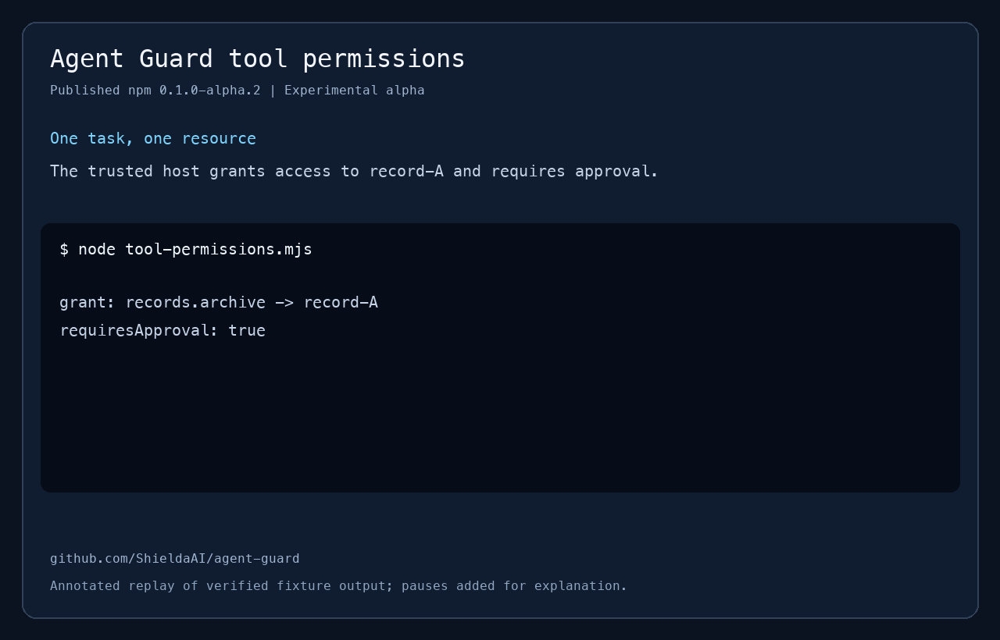

# Shielda Agent Guard

Authorize AI agent tool calls in TypeScript with scoped resources, tenant checks, approvals and budgets. Register a tool, grant a task access to specific resources, and route execution through one guard. Destructive operations can require approval of the exact action before it runs.

**Status: unpublished 0.1.0 candidate; production release held.** The current
Node HIGH security prealert and admission-performance acceptance remain open.
The [candidate release notes](docs/releases/0.1.0.md) track these gates; changing
the version does not clear them. The latest published version is the experimental
`0.1.0-alpha.3` release. The packages use the npm scope `@shieldaai`. The core has
no third-party runtime dependencies and requires Node.js 22 or newer. It controls
registered calls within one process. It is not an OS sandbox or a universal
prompt-injection detector.

Start the defensive-project review with the [protection requirements and design](docs/protection-design.md)
and the [engineering scorecard](docs/protection-assessment.md). The
[acceptance criteria](docs/protection-acceptance.md) define the 9.6/10 target
for each risk category and identify the checks needed for an actual deployment.
The [production readiness review](docs/production-readiness.md) tracks the
current self-hosted candidate separately from those historical construction scores.

Start with the [core tool-authorization example](packages/core/README.md), or use
the [package selection guide](docs/package-guide.md) to choose between MCP
integration, persistent execution, model response validation and dependency
advisory monitoring. The core example and synthetic scenarios need no provider key.

The [tool-permissions walkthrough](docs/guides/tool-permissions.md) demonstrates
an out-of-scope denial, authenticated-host approval and replay rejection using
the published npm package and synthetic records.



The [OpenAI and Anthropic ticket workflow](docs/guides/provider-ticket-workflow.md)
uses one shared protected backend with scoped approvals and provider-specific tool
results. Both examples run offline and test actual reads, writes and private-data
disclosure without API keys.

To try the review decision yourself, run `npm run build` and
`node examples/providers/review-ticket.mjs` from the checkout. Press Enter to
deny the change, or type the exact confirmation to see the updated synthetic ticket.

The [provider outcome evaluation](docs/guides/provider-outcome-evaluation.md)
compares guarded, deliberately permissive and deny-all hosts on paired synthetic
tasks. Run `npm run evaluate:providers -- --output provider-evaluation.json` to
measure completed tasks, unauthorized effects and private-data disclosure.
To measure the actions an OpenAI or Anthropic model chooses, use the public tickets or enroll a
private set of synthetic cases by its SHA-256 digest. To use the result for a release decision,
choose minimum task-success rates in a version 3 configuration. Local validation gives you a
digest that locks the cases and criteria for the paid run. [Model-selected trial guide](docs/guides/model-selected-provider-trials.md)

| Package | Purpose |
|---|---|
| [`@shieldaai/agent-guard`](packages/core) | Scoped task grants, delegation, tenant checks, approvals, shared sensitivity, secret scanning and budget admission |
| [`@shieldaai/agent-guard-mcp`](packages/mcp) | Register MCP tools with explicit metadata approval and host-defined resource resolution |
| [`@shieldaai/agent-guard-executor`](packages/executor) | Experimental durable executor, authenticated task API, governed memory, restricted network and Docker workload isolation |
| [`@shieldaai/agent-guard-scenarios`](packages/scenarios) | Twelve versioned scenarios, each with malicious and benign test cases |
| [`@shieldaai/agent-map`](packages/agent-map) | Experimental scoped HTTP/MCP reference service for Cartography inventory, with a private React/Cytoscape viewer |

The optional [Agent Map](packages/agent-map/README.md) reads published inventory
without participating in execution. It provides team-scoped evidence, access
explanations, snapshot changes and freshness through the same HTTP/MCP contract.
The [company cartography guide](docs/guides/agent-cartography.md) connects
company-owned agents, owners, deployments, permissions, resources, credential
references and relationships. Paged indexes and structured details distinguish
declared access, host assertions, policy candidates and missing evidence.
See the [Cartography plan](docs/cartography-integration-plan.md) for milestone
status and the [viewer](apps/agent-map/README.md) for local preview instructions.
The [pilot runbook](deployment/cartography/RUNBOOK.md) adds a real synthetic
observer-to-viewer deployment, private backups, fresh-graph recovery, operational
difference reports and reproducible performance/rollback checks.
The isolated pilot has retained recovery and graph-load evidence. The current
cartography candidate's uninstrumented admission-performance gate failed; a later
instrumented diagnostic is not acceptance evidence. The runbook and candidate
release notes retain these results and the remaining company rollout gates.

The [source lifecycle command](deployment/cartography/SOURCE-LIFECYCLE.md) explicitly
replaces an enrolled generation after an executor restore or clone. It retires
the old source from current views, blocks republishing it, and preserves the
replacement decision through backup and reconstruction.

Company browser access now has a dedicated [OIDC/HTTPS endpoint](deployment/cartography/IDENTITY.md)
with host-assigned scopes, short-lived sessions, CSRF protection and revocation.
Its private launcher/configuration is separate from the local bearer/MCP service.
Real company-provider enrollment and trusted-certificate browser checks remain
deployment steps; the implementation is tested with disposable HTTPS identities.

An opt-in [single-account AWS collector](deployment/cartography/AWS.md) now fills
the role/user/bucket metadata used by cloud joins. It verifies the exact caller,
publishes complete captures atomically, and shares the observer worker's lock
and polling loop. A separate enrollment flag adds bounded IAM policy capture and
S3 candidate edges with unknown assessments. The scoped API/viewer ties these
candidates to each visible task's execution and resource bindings, retaining
conditions, freshness and unresolved coverage. Live account enrollment remains
a deployment step.

## Published package and candidate checkout

The following installs the published experimental alpha, not the unpublished
candidate:

```sh
npm install @shieldaai/agent-guard@0.1.0-alpha.3
```

Add `@shieldaai/agent-guard-mcp@0.1.0-alpha.3` when integrating MCP tools, or
`@shieldaai/agent-guard-scenarios@0.1.0-alpha.3` to run the scenario catalog. Both depend on
the matching core version. Configuration lives in your application: register tools,
create task grants, and provide an authenticated approval flow where needed.

This checkout prepares `0.1.0` for all five npm packages, with the intended
`latest` tag only after release approval. Build and install its local tarballs
together to evaluate candidate features. The private viewer and Python
Cartography integration are separate source components. See the
[candidate notes](docs/releases/0.1.0.md) for open gates and the
[alpha.3 notes](docs/releases/0.1.0-alpha.3.md) for the published verification record.

## Run locally

```sh
git clone https://github.com/ShieldaAI/agent-guard.git
cd agent-guard
npm ci --ignore-scripts
npm run check
npm run demo
npm run pack
```

The demo uses in-memory fixtures and needs no API key, environment file, or external
service. `npm run pack` creates installable tarballs in `artifacts/`. For local builds,
install the workspace tarballs together into a separate project. `npm run check` also tests
packed packages in a clean temporary consumer, so workspace links cannot hide missing
distribution files.

The synthetic [SafeCall/executor integration](examples/safecall-executor.mjs) uses
the Node SafeCall package installed in the caller's environment, or accepts its
local built entry point: `node examples/safecall-executor.mjs /absolute/path/to/llm-safecall-node/dist/index.js`.
It exercises buffered output validation and actual authenticated budget admission
without cloud credentials. See the [implementation status](docs/implementation-status.md)
for checked features and remaining protected-release gates.

## Approve and execute an action

This integration sketch uses an in-memory record and an approval UI supplied by
your application. For a runnable version with no external services, use the
[ticket review exercise](examples/providers/review-ticket.mjs).

```ts
import { AgentGuard } from '@shieldaai/agent-guard';

const guard = new AgentGuard();
const records = new Map([['record-A', { tenant: 'acme', version: 'v1' }]]);
const fingerprint = guard.registerTool({
  name: 'records.delete',
  description: 'Delete one record',
  requiresApproval: true,
  parse: input => {
    if (!input || typeof input !== 'object' || Array.isArray(input) ||
        Object.keys(input).length !== 1 || !('recordId' in input) ||
        typeof input.recordId !== 'string') throw new Error('Invalid arguments');
    return { recordId: input.recordId };
  },
  resolve: (args, task) => {
    const { recordId } = args as { recordId: string }; // normalized above
    const record = records.get(recordId);
    if (!record || record.tenant !== task.tenantId) throw new Error('Record unavailable');
    return { resourceId: recordId, tenantId: record.tenant, resourceVersion: record.version };
  },
  execute: (_args, { action, task, signal }) => {
    signal.throwIfAborted();
    const record = records.get(action.resourceId);
    if (!record || record.tenant !== task.tenantId || record.version !== action.resourceVersion)
      throw new Error('Record changed');
    // This map operation is synchronous. Use a conditional write/transaction at a real service.
    records.delete(action.resourceId);
    return { value: { deleted: action.resourceId } };
  },
});
guard.approveTool('records.delete', fingerprint);

const task = guard.createTask({
  id: 'cleanup-1', principalId: 'operator-42', tenantId: 'acme',
  grants: [{ tool: 'records.delete', resources: ['record-A'] }],
  budget: { maxCalls: 1, maxConcurrent: 1, maxCost: 0, deadline: Date.now() + 60_000 },
});
const prepared = await guard.prepare(task, {
  tool: 'records.delete', args: { recordId: 'record-A' },
});

// Trusted integration supplied by your application. Deny or close returns false.
declare function reviewInHostUI(input: {
  action: typeof prepared.action; digest: string; expiresAt: number;
}): Promise<false | { authenticatedReviewerId: string; digest: string }>;
const expiresAt = Date.now() + 30_000;
const review = await reviewInHostUI({ action: prepared.action, digest: prepared.digest, expiresAt });
if (!review || review.digest !== prepared.digest) throw new Error('Action not approved');
const approvalId = guard.approve(prepared, {
  approverId: review.authenticatedReviewerId, expiresAt,
});
const result = await guard.execute(prepared, { approvalId });
```

The model receives a dispatcher that selects the host-owned task, not the guard instance, task-creation APIs or approval APIs. An `approverId` string records a host-authenticated identity; it does not authenticate the person by itself. Resolve tenants and resources from trusted service data. Tool schemas are fingerprinted but are not automatically validated as JSON Schema: use a trusted `parse` function to validate/normalize arguments before resolution. Bind mutable resources with `resourceVersion` and compare the version again at the actual effect.

## Protections and boundaries

The source-hosted [Agent Ops ticket workflow](apps/agent-ops/README.md) adds an OIDC
operator interface, persistent conditional ticket updates, receipt-based recovery,
safe task archival and offline key rotation. Its [Linux deployment runbook](deployment/production/README.md)
defines the single-owner Docker Compose profile. The [production plan](docs/production-plan.md)
tracks the broader agent and permissions inventory for Agent Map/Cartography.
The [self-hosted onboarding review](docs/self-hosted-onboarding-review.md) covers
company identity/data enrollment, reviewed imports and safely configurable capacity.

The [scenario catalog](docs/scenarios.md) covers unknown tools/resources, delegation, protected administration, sensitive-data export, exact-action approvals, MCP metadata drift, secret and canary scanning, revocation and failed checks, tenant isolation, budgets, normalized typed arguments and resource-version checks. Catalog 1.2.0 runs twenty-four paired malicious and benign cases. A trusted handler must compare the approved resource version atomically with the actual effect.

All mandatory checks must pass. Custom policy can add restrictions but cannot override a missing grant, required approval, revoked task, tenant mismatch or exhausted budget. The same stored invocation is approved and executed; changing the original arguments does not change it.

The embedded core keeps state in memory. Use one guard instance for a task tree. Restarting loses approval consumption and usage history; separate processes do not share them. The new [executor package](packages/executor/README.md) adds a single-owner encrypted SQLite ledger, scoped authenticated interfaces and conservative crash recovery. It is experimental and does not provide distributed enforcement. Cancellation is cooperative through `AbortSignal`; cost bounds require a trusted adapter to enforce a provider-side maximum and report actual usage. An execution error can occur after a side effect and must not trigger an automatic retry. The separate [Docker profile](deployment/README.md) terminates isolated workloads at resource/time limits; its full platform release gate remains open.

Cost values must be nonnegative safe integers in a consistent host-defined unit, such as microcurrency units. Fractional amounts and unsafe integers are rejected to avoid rounding errors in admission and accounting.

Start with the [threat model](docs/threat-model.md) and [API contract](docs/api-contract.md) when integrating the guard. The [architecture](docs/architecture.md) explains the implementation; [release instructions](docs/releasing.md) cover publishing the packages.

The [release review](docs/quality-review.md) preserves verification of the published
`0.1.0-alpha.1` packages. The [0.1.0-alpha.3 notes](docs/releases/0.1.0-alpha.3.md)
preserve the latest publication; see the [unpublished 0.1.0 notes](docs/releases/0.1.0.md)
and [changelog](CHANGELOG.md) for candidate changes and remaining release gates.

## Contributing

See [CONTRIBUTING.md](CONTRIBUTING.md). Bug reports should include a minimal fixture and an assertion about actual effects. Report security vulnerabilities through [private vulnerability reporting](https://github.com/ShieldaAI/agent-guard/security/advisories/new), following [SECURITY.md](SECURITY.md).

Licensed under [Apache-2.0](LICENSE). Copyright 2026 ShieldaAI contributors.

The [joined MCP isolation acceptance guide](docs/guides/mcp-isolation-acceptance.md) shows how to exercise a disposable peer, credential custody, lifecycle invalidation and unknown-outcome cleanup through the managed connection and durable executor.
