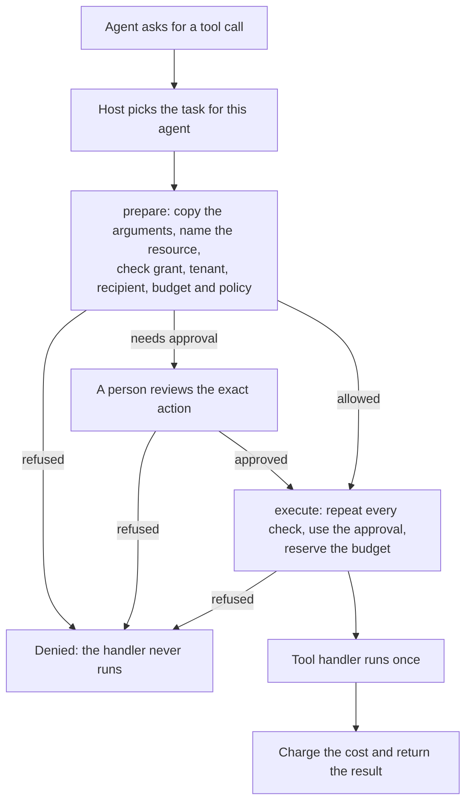

# Architecture

Agent Guard sits between the agent and the tools. The host (your trusted
application code) registers the tools and creates the tasks. The agent only asks
for a call; the guard decides whether it runs. Terms are defined in the
[glossary](glossary.md).

## How a call flows



The same flow as text:

```text
Agent asks for a tool call
        |
        v
Host picks the task for this agent
        |
        v
prepare:  copy the arguments, name the resource,
          check grant, tenant, recipient, budget and policy
        |
        +-- refused ---------------------------> Denied: the handler never runs
        |
        +-- needs approval --> a person reviews the exact action
        |                          |
        |                          +-- refused -> Denied
        |                          |
        v                          v
execute:  repeat every check, use the approval,
          reserve the budget
        |
        +-- refused ---------------------------> Denied
        |
        v
Tool handler runs once
        |
        v
Charge the cost and return the result
```

Three properties of this flow matter:

- **The action is frozen at `prepare`.** The guard copies the arguments and
  records the tool registration and the policy version. What the reviewer
  approves is what runs.
- **Every check runs twice.** `execute` checks the grant, tenant, revocation,
  deadline, policy and budget again against current state. The final checks, the
  use of the approval, the budget reservation and the start of the handler happen
  in one step, so nothing can change in between.
- **An action runs at most once.** A second `execute` of the same action is
  refused.

The host keeps the administrative methods: registering and approving tools,
creating tasks, approving actions, setting the policy and revoking. Never expose
them as agent tools.

## Where state lives

| Package | State | Lifetime |
| --- | --- | --- |
| The guard (`@shieldaai/agent-guard`) | Tasks, approvals, budgets and revocations in process memory | Ends with the process. Not shared between processes. |
| The executor (`@shieldaai/agent-guard-executor`) | The same, in the ledger: an encrypted SQLite file | Survives restarts. One owner process per ledger. |

After an executor restart, budgets, revocations and used approvals are still
there. Tool approvals and prepared actions are not; the host registers and
approves its tools again.

The executor also records what happened to each action. If a handler started and
its result was lost, the action is marked `UNKNOWN` and held for a person to
settle. The executor never runs it again on its own.

## How the packages fit

The guard holds the rules. The other packages build on it: an adapter for
Model Context Protocol (MCP) servers, the executor, a test suite and an
inventory service.

```text
                      your application (the host)
                                 |
        +------------------------+-------------------------+
        |                        |                         |
   the guard               MCP adapter               the executor
 @shieldaai/           @shieldaai/              @shieldaai/
 agent-guard           agent-guard-mcp          agent-guard-executor
 checks every call     registers the tools      the same checks, with
 in memory             of an MCP server with    a ledger, a token per
                       the guard or executor    task, memory tools and
                                                a Docker sandbox

 @shieldaai/agent-guard-scenarios   thirteen test scenarios you can run
                                    against the guard or your own wrapper
 @shieldaai/agent-map               read-only inventory of agents, built
 (experimental)                     from the executor's inventory export
```

- **The guard** has the rules and no third-party runtime dependencies. Every
  other package uses its checks; none adds a second set.
- **The MCP adapter** turns the tools of an MCP server into registered tools. It pins each tool's reviewed definition and stops all
  calls when the server's tool list changes.
- **The executor** is for agents that run in another process or must survive a
  restart. Agents hold a task token and call it over HTTP; the host keeps the
  administration object.
- **The scenarios** check that an integration still denies the hostile cases and
  still allows the ordinary ones.
- **Agent Map** shows which agents exist and what they can reach. It never
  authorizes or runs anything.

Choose packages with the [package guide](package-guide.md). The
[API contract](api-contract.md) has the exact rules, and
[support and limits](support-and-limits.md) says what stays with the host.
