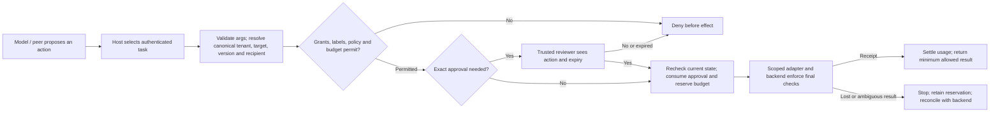

# Agent protection requirements and design

**Decision:** mediate the effect. The model may believe a hostile email, ticket,
tool description or another agent. That belief must not give it a new identity,
credential, destination, approval or spending limit. Judge the system by what
the backend changed or disclosed, and by whether legitimate tasks still finish.

This specification covers the TypeScript core, the single-owner durable executor,
the managed MCP and isolated workload profiles, and the read-only Agent Map.
Project acceptance uses code review, normal workflow checks and functional
regressions under the [engineering criteria](protection-acceptance.md).
Deployment enrollment and representative field measurements have their own
checklists. The construction review requires no penetration test.
Use the [companion assessment](protection-assessment.md) for the implementation
review. The risk identifiers below refer to the [OWASP Top 10 for Agentic
Applications](https://genai.owasp.org/resource/owasp-top-10-for-agentic-applications-for-2026/).
The MCP design also follows the [protocol's security guidance](https://modelcontextprotocol.io/docs/2025-11-25/tutorials/security/security_best_practices)
on confused deputies, token passthrough, SSRF, session theft and compromised peers.

## Deployment boundary

| Actor or asset | Authority and trust assumption |
| --- | --- |
| Model, retrieved text, files, memory, tool results and peer metadata | Untrusted input, including plausible instructions and purported approvals. They have no administrative methods, direct backend client or persistent bearer. |
| Application host | Authenticates identity, sets intent and tenant, issues task grants, selects trusted tools and policy, and owns the credential broker. A compromised host can bypass this library. |
| Reviewer | A host-authenticated person or a separately enrolled deterministic policy. Display which one acted. Model text and a caller-supplied reviewer ID cannot stand in for either. |
| Executor and ledger | The only route to protected effects. One in-memory guard for ephemeral trusted code, or one trusted SQLite owner for durable tasks. Enforce admission across ancestors; retain evidence after ambiguous dispatch. |
| Tool service and provider | Enforce the same tenant, target, resource version, credential scope and provider-side ceiling at the effect. A wrapper cannot constrain an overprivileged handler after it starts. |
| Hostile code or MCP peer | Separate OS/service identity. No host socket, raw SDK, secrets, broad filesystem or ambient network. Pin the reviewed image/endpoint and expose only bounded, explicitly brokered operations. An approved peer can still lie or misuse its own authority. |
| Observer / Agent Map | Read-only evidence for the viewer's authorized scope. The map must never grant permission, reveal another scope or treat a stale inventory edge as proof of effective access. |

**First deployment decision:** enumerate every way this agent can read, write,
send, spawn a process, call a provider or start another agent. Remove or isolate
unmediated paths before relying on any score. A direct shell or alternate MCP
connection with the same credentials defeats even a flawless admission check.

## Requirements and acceptance

P0 means a failure can permit an unauthorized effect, sensitive disclosure, or
unsafe retry; it blocks the affected deployment. P1 means evidence or
operability required before rollout. An authorized, useful control case is
required alongside **every** negative case. Do not count a denial message, a
model's claim of success or a screenshot as evidence of an effect.

| ID / priority | Risk and required behavior | Acceptance at the effect |
| --- | --- | --- |
| R1 · P0 | **Goal manipulation and tool misuse** (ASI01/02). Treat all content as data; host fixes the task, tool set, exact resources and tenant. Validate and freeze arguments; reject extra authority fields. Resolve from trusted service state. | Inject a foreign write/read, forged tenant, admin tool and partial provider batch. No forbidden handler or disclosure. Valid ticket read and approved update change exactly one permitted record. |
| R2 · P0 | **Identity, delegation and agent messages** (ASI03/07/10). Bind handles/tokens to authenticated host context. Attenuate grants, recipients, budgets and deadlines through ancestry. Revoke descendants and linked handoffs. Treat peer text as a request. | Forged handle, copied token in the wrong role, widened child, revoked or expired task: zero protected results/effects. A narrower child completes a permitted call. No unsupported federated dispatch. |
| R3 · P0 | **Human trust and action substitution** (ASI09/02). Show tenant, operation, canonical target, change, version and expiry from the prepared action. Authenticate reviewer outside the model; bind one decision to that action; recheck mutable state at dispatch and at backend commit. | Alter args, replace tool/policy, race two approvals, withhold approval, extend expiry or change target version. At most one exact approved effect. An empty or closed review never means yes. |
| R4 · P0 | **Secrets, sensitive data and egress** (ASI02/03/06). Minimize returned fields. Propagate sensitivity across family, handoffs, governed memory and artifacts. Require explicit external recipient; use audience-bound broker credentials and restricted DNS/HTTP; no redirects or private destinations in the public profile. | Send to a sibling recipient, poisoned DNS, redirect or private host; try explicit raw credential reflection and private-note disclosure. No protected sink receives it. A narrowly scoped request succeeds. Literal scanning alone does not establish confidentiality. |
| R5 · P0 | **Tool and artifact supply chain** (ASI04). Pin tool metadata and connection generation, image digest, artifact bytes and authorized builder. Quarantine drift; a metadata approval does not authorize an action. | Replace schema/peer generation, key, attestation, actual artifact or image; old permission cannot dispatch/import. A reviewed new generation and an exact attested artifact work. Organizational key enrollment is separate evidence. |
| R6 · P0 | **Unexpected code execution** (ASI05). Run untrusted code only in the isolated profile: no network, host credentials, management socket or writable host mount; nonroot, dropped capabilities, limits, bounded reviewed exports. | Run real guest code; attempt host reads/writes, egress and malicious archive exports. Allowed input/selected output work, limits terminate the workload, and cleanup leaves no owned container. Repeat on every claimed host/VM profile. |
| R7 · P0 | **Memory and context poisoning** (ASI06/07). Namespace memory, bind its source, version writes, quarantine/roll back bad content, and preserve sensitivity on reimport. Retrieved or signed data never issues grants or approves actions. | Foreign memory fails; stale writes and quarantined reads fail; valid rollback and authorized reads work. Reimporting labeled data cannot reopen external sends. Within-scope false text remains possible. |
| R8 · P0 | **Cascading failures and runaway agents** (ASI08/10). Bound input, calls, concurrency, cost and time; reserve before effect; cancel/revoke at deadline; keep uncertain work charged or reserved. A fresh correlation ID is not a retry policy. | Race requests and revoke/expire in flight; interrupt after admission and after effect. Limits hold. Recover using a trusted receipt; never dispatch another effect to learn if the first happened. A benign bounded run settles. |
| R9 · P1 | **Operational evidence and access UX** (ASI03/09/10). Separate decision evidence from authority. Scope reads; distinguish absent, unsupported, denied, stale and unknown. Clear evidence on identity loss. Keep args, credentials and customer text out of traces. | Compare two scopes and revoked sessions, check failure and empty states, exercise keyboard navigation, and reconstruct one denied and one successful call without raw payloads. Show a drop/freshness indicator when evidence is incomplete. |
| R10 · P1 | **Effectiveness and rollout** (all ten risks). Grade both safety and useful completion, against permissive and deny-all controls. Pin candidate, deployment, thresholds, workload and reviewers before release. | No unauthorized writes/reads or canary disclosures. Every planned benign/attack pair meets the pre-enrolled success floor; missing rows or failed controls cannot pass. Rehearsal cannot satisfy a company-pilot gate. |

## Failure handling for the operator

| Observed state | What to show | Next action |
| --- | --- | --- |
| Denied before dispatch | “No change submitted.” Show safe reason and authorized target, without revealing a foreign object exists. | Correct the request or ask the task owner to review the grant. Never have the model grant itself access. |
| Waiting for review | Exact target and change, version and expiry. Deny/close is safe; accept requires a deliberate action. | Approve only the selected action. Denying a proposal differs from stopping the task; revoke to end its authority. |
| Stale or expired before dispatch | “Review expired or target changed.” | Read current state and request a new decision. Never refresh the old approval. |
| Confirmed | Use a result or backend receipt bound to the action, never assistant prose. | Report only the confirmed change and minimum necessary data. |
| Submitted, outcome unconfirmed | “It may already have happened.” Keep the host action reference and receipt trail private to the operator. | Stop this run. Look up the backend operation/receipt, check that work ended, then reconcile the durable ledger. Do not auto-retry or release budget on a timer. |
| Inventory/session unavailable | Clear sensitive results on auth loss. Label stale or unsupported evidence explicitly. | Reauthenticate or refresh the capture; absence of an edge is not authorization. |

Release owners should start with one tenant and one read-only path, pin the build,
exercise revocation and rollback, then expand only the tested boundary. Use the
[pilot evidence procedure](../guides/pilot-review.md), [isolation procedure](../guides/mcp-isolation-acceptance.md),
and [reserved model trial procedure](../guides/model-selected-provider-trials.md).
