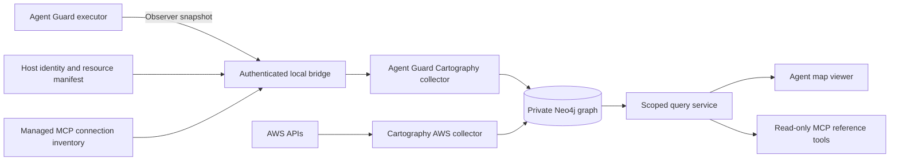

# Cartography integration plan for Agent Guard

Plan date: 29 October 2026. Updated: 31 October 2026. Status: all repository milestones in this Cartography plan are implemented, including explicit source-generation replacement uncovered by an acceptance audit. Supersession, publication fences, scoped visibility and lifecycle-preserving reconstruction passed the final regression suites. The isolated pilot previously passed its provisional admission-latency target after a bounded snapshot-local reference cache removed repeated hashing; representative deployment measurements remain required. Actual company-provider enrollment, trusted-browser TLS checks, live AWS and independent security-review rollout gates remain deployment-specific. Implementation completion does not certify production deployment or effective cloud authorization.

The [contract and compatibility implementation](../integrations/cartography/README.md) provides a strict core inventory schema, an external Cartography stage, immutable graph projections and a disposable Neo4j test runner. The first milestone passed 84 unit cases and 15 real-Neo4j integration cases, including the CLI, publication failures and cleanup isolation, plus a clean installed-wheel consumer check.

The [executor exporter](../packages/executor/README.md#inventory-for-the-trusted-host) implements the second milestone: persistent ledger identity with atomic schema-1 migration, an opt-in host API for complete tenant snapshots, normalized grants, explicit unavailable tool flags and immutable allowlisted data. Resource and recipient references default to tenant-scoped keyed hashes. New executor tests cover migration/recovery, export purity, confidentiality, bounds and scope; the Python suite also validates snapshots generated by the actual executor.

The [observer HTTP transport](../packages/executor/README.md#observer-http-transport) is implemented with a separate loopback listener, independently namespaced credentials, fixed tenant/profile scopes, response bounds, deadlines, request quotas and concurrency limits. Tests cover actual HTTP/socket rejection and recovery, and the Python consumer validates actual observer responses.

The [host manifest and binding implementation](../packages/executor/README.md#host-owned-manifest-and-bindings) adds a strict standalone schema, immutable composition into the `host` profile, fixed observer profile selection and metadata-only Cartography projection. Associations retain separate manifest revision/time and exact source/tenant identity while core authority remains unchanged. Graph publication enforces manifest revision/content consistency and profile pinning.

The [MCP projection](../packages/executor/README.md#mcp-inventory-composition) adds pure managed connection observations, separate lifecycle/authorization/descriptor revisions, opaque transport references, bounded `host-mcp` composition and fixed observer delivery. Cartography projects connection and operation evidence, preserves independent session watermarks and publishes explicit unavailability without retaining stale ready operations.

The [collector](../integrations/cartography/README.md#observer-collection-and-restart-recovery) adds bounded observer retrieval, exact source/profile enrollment, a serial multi-source polling queue, protected atomic snapshot/health receipts, explicit restart replay and scoped retention. [Cloud joins](../integrations/cartography/README.md#aws-inventory-joins) match existing pinned AWS role/user/bucket inventory with explicit account ownership and independent freshness. Object/prefix references retain containment semantics, optional failures publish unavailable evidence, and shared provider nodes are never cleanup targets. A packaged S3 permission mapping preserves upstream limitations. The isolated pilot adds bounded performance benchmarks, private operational difference reports and recovery checks. Central TLS bridge deployment and live AWS validation remain deployment-specific gates.

Second-milestone validation on 29 October 2026: `npm run check` passed all 242 tests with zero skips on macOS/Node 26, including the pinned Linux Docker sandbox cases and the installed-package consumer. The Python suite passed all 96 unit cases, including 12 exporter/consumer bridge checks; Ruff lint and formatting passed. The executor added 48 inventory tests. These checks do not constitute new native Linux/Windows platform certification or a polling performance benchmark.

Observer-transport validation on 29 October 2026: `npm run check` passed 276 tests with zero skips, including 34 new HTTP/transport tests, the pinned Docker sandbox cases and a clean installed-package observer client. All 104 Python unit tests passed, including eight actual HTTP-to-consumer checks; Ruff lint/format and the runnable observer example's canonical-schema validation passed. Polling performance and native Linux/Windows platform certification remain separate gates.

Host-manifest validation on 30 October 2026: `npm run check` passed 349 tests with zero skips, including 73 new manifest/composition/host-observer cases and installed-package host-profile checks. All 164 Python unit cases and 25 disposable-Neo4j integration cases passed. New graph tests cover exact metadata relationships, independent manifest revisions, conflicts/races, profile pinning and cleanup isolation. Ruff, wheel/sdist builds, a wheel rebuilt from the sdist, isolated installed-consumer validation of both schemas, and the runnable host-manifest example passed. These results do not certify cloud policy evaluation, MCP discovery or polling performance.

MCP-projection validation on 30 October 2026: `npm run check` passed 419 tests with zero skips, including 70 new lifecycle/composition/HTTP cases and installed-package MCP exports/profile checks. All 243 Python unit cases and 38 disposable-Neo4j cases passed. The actual SDK-to-executor-to-observer bridge verifies descriptor drift/removal, lifecycle state, tenant isolation, no observation side effects and secret exclusion. Neo4j tests cover independent revisions, unavailable captures, reconnect/session replay, publication races, exact edges and scoped cleanup. Ruff, all three packaged schemas, wheel/sdist builds, a wheel rebuilt from the sdist and isolated installed-consumer validation passed; the disposable database was removed. Live polling, provider joins and production deployment validation remain separate work.

Collector/cloud-join validation on 30 October 2026: all 382 Python unit tests passed, including 139 new transport/archive/publication/cloud/mapping cases. All 54 distinct disposable-Neo4j cases were verified across the full suite and a focused five-case CLI rerun after the final diagnostic-output fix. The 16 new integration cases cover real executor HTTP collection, restart replay, worker exclusion, serial-source failure isolation, revocation, retention, exact cloud joins, provider drift/failure, publication CAS and shared-provider cleanup protection. `npm run check` still passes all 419 tests with zero skips. Ruff, wheel/sdist builds, rebuilding the wheel from the sdist, installed collector/archive APIs and the packaged upstream-parsed AWS mapping passed. Disposable databases were removed. Cloud tests use synthetic provider inventory with the pinned real schema; no live AWS APIs or production credentials were used. Polling/admission performance, remote TLS bridge deployment and live AWS validation remain pilot gates.

Integrate Cartography as an optional, self-hosted inventory and graph service around Agent Guard. Agent Guard remains responsible for admission, approvals, revocation and execution. The integration will explain which tasks have declared access, how delegation restricts that access, which identities and infrastructure are involved, and how current the supporting evidence is.

The first release should support one company, several independent executor installations, one AWS account and a bounded set of resource mappings. AWS is the pilot choice because Cartography already exposes IAM and resource relationships; it is a planning assumption, not a discovery of the company's cloud environment. Establish a working snapshot-to-graph path before adding other cloud providers or employee-device discovery.

## Evaluation and decision

Use Cartography's collectors, Neo4j integration and declarative graph models. Implement an external Agent Guard collector package with a custom sync entry point, rather than maintain a Cartography fork. Add a small authenticated query service and graph viewer. Keep Python and Neo4j outside the existing npm packages and enforcement process.

| Area | Finding | Integration decision |
| --- | --- | --- |
| Infrastructure inventory | Cartography models cloud resources and identities and supplies existing provider collectors. | Reuse its canonical schemas/query builder and IDs. The bounded metadata path uses five fixed SDK reads; explicit policy opt-in adds GetAccountAuthorizationDetails without upstream orchestration or cleanup. |
| AI inventory | AIBOM imports detected agents, tools and other AI components and connects them to images or repositories. | Link runtime deployments to these components when an exact artifact identity is available. Create separate Agent Guard labels for tasks, grants and connections. |
| Extension mechanism | Custom `Sync` stages and declarative node/relationship schemas are supported. | Ship an independently versioned Python package inside this repository. Pin Cartography and test its integration API. |
| Permission mapping | AWS permission relationships cover configured actions. Allow conditions are retained; conditional denies are currently treated as unconditional when computing edges. | Treat cloud edges as permission evidence. Missing edges do not prove denial; present unresolved conditions explicitly. |
| Refresh and cleanup | Loads commit in batches. Cleanup uses update tags; concurrent runs for overlapping scopes can delete each other's data. | Stage complete Agent Guard snapshots, publish them atomically, and serialize ingestion. Never clean up shared cloud nodes. |
| Product interface | Ingestion and graph queries do not supply this project's full agent-reference contract or team visibility policy. | Build fixed query endpoints, a read-only MCP interface and a focused viewer. |
| Operations | A Python collector and Neo4j add deployment, backup and upgrade work. | Make the integration optional. Failure of the map must not affect Agent Guard execution. |

Cartography is a good foundation for this integration. It does not remove the need to model Agent Guard semantics, resolve identities, protect topology data or verify provider-specific access. The [AIBOM module][c-aibom], [custom sync documentation][c-custom], [AWS permission mapping][c-permissions] and [operations guide][c-ops] define these boundaries.

### Source and compatibility baseline

| Component | Evaluated baseline |
| --- | --- |
| Cartography | Release `0.144.0`, commit `66ead780c590c2db63947286fa8d5131f44697f8`. Pin this version for the initial integration. |
| Published Python artifact | `cartography-0.144.0-py3-none-any.whl`, SHA256 `89ee88f4fca44a1a74e10de253475f14ba84154b5e88c908ad2a34412b26872a`. Selected sync, CLI, loader, cleanup and AIBOM source files match the release commit. |
| Python | Package metadata requires Python 3.11 or newer. Use Python 3.13 for the integration and lock transitive dependencies. |
| Neo4j | The first milestone validates Community 5.26.32 at the exact multi-platform image digest in [neo4j-image.txt](../integrations/cartography/neo4j-image.txt). Cartography's minimum remains 5.23; the tested image is an integration baseline, not a production deployment certification. |
| Agent Guard | Working tree based on `79010852b61dd64e7b1770c42498f1beef4d63ad`, including existing uncommitted executor and managed-MCP work. The executor requires Node 22.13 or newer. |

The initial evaluation includes source inspection and published-artifact comparison; the first milestone adds disposable-Neo4j compatibility tests. Live cloud correctness, throughput and production readiness remain explicit implementation gates below. See the [release][c-release], [artifact metadata][c-artifact], [package metadata][c-package], [installation requirements][c-install] and local [implementation status](implementation-status.md). Existing published npm packages must not be assumed to contain the working-tree APIs.

Cartography is Apache-2.0. Neo4j Community Edition is GPLv3; Enterprise has separate licensing and provides database roles and fine-grained access controls. Keep the database as a separate service and retain applicable notices. A Community deployment will rely on the application boundary for read-only queries and team visibility; it must not advertise database-enforced reader privileges. See [Neo4j licensing][neo-license] and [authorization capabilities][neo-auth].

## Architecture and scope

The pilot includes inventory, delegation and provenance paths, declared grants, approval requirements, MCP connection state, explicit cloud identity/resource links, snapshot differences, and evidence-based queries. It does not include automated permission changes, an IAM authorization engine, arbitrary agent discovery, automatic tool execution, real-time enforcement or a new distributed executor.

Start with executor installations. The embedded `AgentGuard` core stores tasks in a `WeakMap`, so it cannot enumerate all tasks. A future embedded adapter should use an explicit host registry or lifecycle export; do not replace the weak map with a permanent task registry just to satisfy discovery.

## Agent Guard changes

### Snapshot contract and persistent identity

The first milestone added `schemas/agent-guard-inventory-v1.schema.json` with `schemaVersion: 1` and `profile: core`. It also supports `host` with its required manifest and `host-mcp` with managed connection observations. Core rejects both enrichments; host rejects MCP payloads. Readonly types and standalone manifest/MCP schemas share the embedded definitions, and all three schemas ship in Python wheels/source archives. Cloud joins are separate importer observations and do not alter the source envelope. The contract remains independent of Cartography.

The existing [ledger](../packages/executor/src/store.ts) contains the required task relationships, while [TaskSnapshot](../packages/core/src/types.ts) omits grants, parents and revocation. Implemented: `DurableExecutor.inventorySnapshot({tenantId})`, enabled by constructor `inventory: {companyId, sourceId, enrollmentGeneration, referenceMode?}` configuration, uses an explicit field allowlist. It reads the ledger once, projects synchronously and returns an immutable result. It invokes no policy, parser, resolver, execution or authorization-clock callbacks and does not consume approvals or change budgets during export. Observation time uses wall time independently of the authorization clock.

Add a persistent random `inventoryInstanceId` to newly created ledgers and initialize it once for existing schema-1 ledgers under the store's existing transaction mechanism. Keep it additive within schema 1, whose current reader preserves extra properties. Test legacy ledger migration, reopen, rollback of a failed migration and compatibility with the previous reader. A new ledger gets a new ID. Add a host-controlled `enrollmentGeneration` to the source configuration and rotate it explicitly after restoring or cloning a ledger; the collector must approve the new enrollment before publication and retire the previous source generation. Reject decreasing revisions within an enrollment, but do not claim that counters detect every restore: a restored source can advance past the previous revision before the next poll. Do not roll back authorization state to repair the graph.

The host also supplies a stable installation `sourceId`. Graph identity is scoped by company, source, enrollment generation, ledger instance and tenant. Neither `revision` nor `epoch` is an installation ID: revision tracks committed mutations, while epoch changes on restart or policy changes. Each v1 snapshot covers exactly one tenant; collector enrollment fixes that tenant and its visibility profile, so an accidentally narrower request cannot retire another scope's data.

| Snapshot field | Required content |
| --- | --- |
| Envelope | Schema version, source ID, enrollment generation, ledger instance ID, tenant scope, unique snapshot ID, generation time, ledger revision, policy epoch, manifest revision and coverage. |
| Tasks | Native ID, principal/tenant IDs, parent task, provenance source task, family, grants, budgets, recipients, control-plane flag, revocation, sensitivity and usage counters. |
| Tools | Name, fingerprint, revision, current registration availability, approval state, declared approval requirement, control-plane flag and maximum cost. |
| Host associations | Agent/deployment identity, owner/team/environment, task associations, tool execution bindings and canonical external identity/resource references, with evidence origin. |
| MCP | Safe connection identity, session ID, revision, state and registered operation names, kinds and fingerprints. |
| Completeness | Per-component status, collection time and supported semantics. Optional missing MCP or cloud data must not invalidate a complete task snapshot or imply no connections. |

Tool flags come from live registered definitions. After restart, retained tool records can exist without live handlers and their approval is reset. Represent unavailable flags as unknown, not false. Export only tools relevant to the observer's tenant scope, plus any explicitly authorized shared inventory.

Exclude tokens and token hashes, encryption keys, approval IDs, arguments, results, memory content, arbitrary tool metadata, raw schemas and descriptions. The exporter defaults to tenant-scoped, domain-separated HMAC references for resource selectors and recipients, preserving only the exact resource wildcard `*`. Credential-bearing URLs in those fields therefore remain private. Explicit `referenceMode: 'raw'` is for host-reviewed non-secret aliases/recipients intended for export. Other identifiers remain visible and must contain no secrets. Changing reference mode or the encryption key requires a fresh enrollment generation to avoid changing projection content at an unchanged ledger revision.

Use a complete response for v1: a proposed 8 MiB encoded-response cap and 10-second request deadline, configurable within tested bounds. Synchronous ledger decryption/projection cannot be interrupted by an HTTP timer; bound record counts and source bytes as well, measure generation time, and benchmark admission latency while polling. Use a provisional admission p95 regression budget of 10 percent against the same workload without inventory enabled. Exceeding a limit returns a specific failure, never a truncated response labeled complete. These are pilot targets to validate, not current guarantees. If pagination becomes necessary, paginate one retained immutable snapshot with bounded lifetime; never page across independent live ledger reads.

### Observer transport

Implemented: `startInventoryServer()` in `packages/executor/src/inventory-http.ts` exposes only `POST /v1/inventory/snapshot` on `127.0.0.1`. The host installs independent `createInventoryObserverToken()` credentials mapped to fixed `tenantIds` and a `core` or `host` profile. Host credentials require a startup-validated manifest for each allowed tenant; core credentials never receive manifest data. A request body contains exactly one `tenantId`, never expands its scope or filters that tenant's task inventory. The `agi_v1.` credential namespace cannot overlap with task/admin token formats, and the listener is separate from the existing [task/admin server](../packages/executor/src/http.ts).

The listener enforces strict JSON/body/header limits and constant-time comparisons over hashed credentials. It returns `Cache-Control: no-store`, rejects browser-origin requests, upgrades and CONNECT, and allows Node's standalone fetch-mode header for collector compatibility. It defaults to 16 KiB request bodies, 8 MiB responses, 10-second request/socket deadlines, four active requests, 32 connections and 60 requests per credential per minute, with an additional bounded global quota. Limits are configurable within tested bounds. It checks complete serialized output and elapsed generation time before success; synchronous projection is bounded but cannot be interrupted. The collector receives an observer credential, never an admin token, task token or SQLite key. `examples/inventory-export.mjs` demonstrates a synthetic local poll without logging its credential.

For company collection, use a configured authenticated transport bridge on each protected host. The bridge must authenticate the central collector, verify TLS identities, restrict the reachable route and keep its credentials outside agent workloads. Do not change the existing executor listener to a public address. Destination addresses come from operator configuration, not model arguments or imported graph data; reject unexpected redirects.

### Host associations and MCP inventory

Implemented: keep a versioned host-owned manifest alongside deployment configuration, validate it with `validateInventoryManifest()`, then use `composeInventorySnapshot(core, manifest)` or the observer's fixed `host` profile. It maps local task IDs to agent/deployment IDs and supplies owner/team/environment metadata. Task-to-agent association is optional; unassigned tasks remain visible as unassigned. The current `principalId` is an application identity, not proof of an AWS role. Composition validates both inputs without mutation, preserves every core authority field/capture timestamp and adds a fresh snapshot ID/time plus separately captured manifest evidence. Missing/mismatched bindings fail the host request; no partial host data or implicit core fallback is returned.

Resource bindings identify `(source, tenant, tool, resourceRef)` and the external canonical resource, applicable action and scope. `resourceRef` is the already-exported selector, including its opaque representation; raw aliases are never guessed or silently substituted. Tool context matters because local resource IDs need not have the same meaning across adapters. The validator retains exact AWS account/partition/ARN information and distinguishes bucket, object and prefix scope. An object grant must not become a grant over every object in a bucket. Wildcard selectors cannot be externally bound. Keep unmapped resources local and unresolved. Never join identities on display names. References are host assertions with unknown permission assessment; no cloud API or IAM lookup is implied.

Execution bindings identify the deployment/tool and optional MCP connection reference declared by the host, together with static execution identity or explicit dynamic/unknown selection. The latter requires a null identity. Keep the task's calling principal separate from this execution principal. Connection IDs do not establish current MCP availability. Never combine a task's AWS-role association with permissions of a tool that executes under another identity. The source profile and manifest ID are pinned at publication; changes require a new enrollment generation. The current lifecycle command retires predecessors only within the same profile; cross-profile retirement remains unsupported. Manifest revision advances independently of the ledger, with rollback and same-revision content conflicts rejected both at staging and publication.

Implemented: `ManagedMcpConnection.inventory()` in [managed.ts](../packages/mcp/src/managed.ts) returns immutable allowlisted metadata, manager session identity, an opaque transport reference and the existing statuses `connecting`, `refreshing`, `ready`, `quarantined` and `closed`. It exports current operations only when ready and does not call authorization, resolution or the network. Inventory revision changes with lifecycle state; descriptor-only metadata revision distinguishes registry drift from authorization epoch changes. The host composer uses explicit tenant/connection bindings and exact registered fingerprints; arbitrary tool metadata and remote descriptions never establish associations or trust.

Executor, manifest and MCP state have separate revisions. Record their individual capture times and revisions; do not claim a single atomic snapshot across them. Read MCP revisions before and after composition and mark changed components incomplete or retry within the bound. A valid task snapshot can publish while an optional MCP component is unavailable; expose its previous receipt only as historical evidence, never carry an old `ready` connection state forward as current. Missing or invalid mandatory task data prevents publication of the entire new projection.

## Graph model and permission semantics

Use namespaced labels and relationships owned by this integration. Exported entities have stable logical IDs. A graph import has a globally scoped `projectionId` derived from company, source, enrollment generation, ledger instance, tenant, exported snapshot ID and a fresh import-attempt ID. Versioned projection nodes use a storage ID derived from `(projectionId, entityId)` and retain `entity_id` for comparison across snapshots. A `GuardSnapshot` stores this projection ID as its graph ID and keeps the exported snapshot ID separately. This allows retries to stage safely without overwriting a published view.

| Label | Meaning and key relationships |
| --- | --- |
| `GuardSource` | Installation and enrollment identity; points to its published snapshot for each authorized tenant scope. |
| `GuardSnapshot` | Collection receipt, revisions, completeness and generation; owns the projection nodes below. |
| `GuardAgent`, `GuardDeployment` | Host-declared agent and runtime deployment; owner/team/environment; deployment `G_INSTANCE_OF` agent. |
| `GuardTask` | Task authority and state; optional host `G_ASSIGNED_TO` deployment, `G_ACTS_AS` local principal, `G_DELEGATED_FROM`, `G_DERIVED_FROM`, `G_HAS_GRANT`. |
| `GuardPrincipal` | Local calling-principal reference, never implicitly joined to a cloud execution identity. |
| `GuardTool` | Observed registration metadata or an unresolved granted tool. MCP operations explicitly reference matching registrations. |
| `GuardMcpConnection`, `GuardMcpOperation` | Observed lifecycle/descriptor revisions and scoped operations, with unavailable records when capture fails. |
| `GuardExecutionBinding` | Host evidence: `G_EXECUTES_TOOL`, `G_EXECUTES_FOR` deployment and optional static `G_USES_IDENTITY`; `G_VIA_CONNECTION` in host-mcp. Dynamic/unknown identity remains null. |
| `GuardGrant` | One declared tool/resource selector and its source; `G_FOR_TOOL`, `G_TARGETS`. |
| `GuardResource` | Local tool/resource selector, including unresolved and wildcard selectors. |
| `GuardResourceBinding` | Host `G_BINDS_SELECTOR` local resource and `G_MAPS_TO` an external reference; explicit actions and exact/prefix scope. |
| `GuardExternalResource`, `GuardExternalIdentity` | Source-scoped host assertions retaining exact AWS account/partition/ARN and resource kind. Optional `G_CLOUD_MATCH`/`G_CLOUD_CONTAINER` links capture exact provider evidence with independent freshness and unknown permission assessment. |

`parent` is delegation: every ancestor imposes mandatory grant and budget restrictions. `sourceTaskId` is provenance: it propagates sensitivity/revocation relationships but does not make source grants the child's authority ancestors. Preserve this distinction in queries and UI. The exact behavior comes from [authorization.ts](../packages/core/src/authorization.ts) and [executor.ts](../packages/executor/src/executor.ts).

A grant names an exact tool and exact resource IDs or the literal resource wildcard `*`. Keep wildcard grants as selectors; do not create edges to every resource in the cloud inventory. Do not derive read/write/delete semantics from a tool's name. Those semantics require a host binding, and unresolved bindings stay unknown.

Return three separate dimensions for every access explanation:

- **Evidence:** declared Agent Guard grant, operator association, cloud policy relationship or historical observation.
- **Assessment:** potentially permitted, blocked by a supported Agent Guard gate, conditional, or unknown; include the gate and the scope of the conclusion.
- **Freshness and coverage:** source revision/time, current/stale status, missing providers and unresolved conditions.

Passing exported mandatory gates does not establish permission to execute: custom policy, request arguments, resource resolution, approvals, concurrent reservations and backend authorization may still change the outcome. A blocked Guard path is not proof that the same deployment lacks a direct cloud or shell path. Display known direct identity paths separately and label uncollected paths as a coverage gap.

Link deployments to existing AIBOM components only with exact image digest, repository revision or another documented binding. An AIBOM component is a detected software definition; it is not the task or runtime identity. Preserve the source and confidence of each association.

## Python collector and publication protocol

Create `integrations/cartography/` with its own `pyproject.toml` and lockfile. Depend on `cartography==0.144.0`; keep the release hash in dependency provenance. Provide an `agent-guard-cartography` console entry point that builds a custom `Sync` with the Agent Guard stage. The wrapper owns its configuration and observer credentials. Do not patch upstream `Config` or assume installing a Python entry point makes `--selected-modules agent_guard` work.

Define models using Cartography's `CartographyNodeSchema`, `CartographyNodeProperties`, `CartographyRelSchema`, `PropertyRef` and relationship matchers. Load through `cartography.client.core.tx.load`; use `GraphJob.from_node_schema` for cleanup within a single staging snapshot. These are pinned integration APIs, not a promise of compatibility across future releases. The loader ensures indexes; add and test unique constraints for the integration's storage IDs before collection.

For snapshot-scoped models, use `scoped_cleanup=True` and a `sub_resource_relationship` targeting `GuardSnapshot`. Its matcher must bind `id` through `PropertyRef('GuardSnapshotId', set_in_kwargs=True)`. Pass the projection ID as `GuardSnapshotId`, with the same update tag for load and cleanup; use `cascade_delete=False`. Validate exact API signatures in the first integration test. See [loader][c-load], [graph jobs][c-jobs] and [cleanup generation][c-cleanup].

The collection sequence is:

1. Acquire the pilot's single-worker ingestion lock. Validate configured source identity, observer scope and expected ledger instance.
2. Fetch and validate the entire snapshot before graph writes. Reject unknown schema majors, duplicate IDs, malformed references, oversized inputs and decreasing revisions for the same instance. Retain the previous snapshot on failure.
3. Store the minimized immutable snapshot and receipt in protected local storage. Give each attempted graph import its own staging namespace; retrying the same completed snapshot is idempotent.
4. Load all Agent Guard projection nodes and relationships into that namespace, using the current Cartography update tag. Resolve external links only against exact identities already present in provider inventory. A missing match produces an unresolved binding, not a synthetic cloud permission.
5. Validate counts, required parent references, scope and component coverage. Require complete mandatory task data; retain explicit optional-component gaps. In one Neo4j transaction, mark the mandatory snapshot complete and replace the relevant `GuardSource` publication pointer. Use a compare-and-set against the previous pointer to prevent an older worker from overwriting a newer publication.
6. Retire older projection generations only after publication and the maximum query/cursor lifetime has elapsed. Delete only allowlisted Guard labels and integration-owned links for exact obsolete projection IDs, with checks excluding the current and previous projection in the deletion transaction. Shared AWS/AIBOM nodes are never deletion targets.

Cartography's sync session does not make a whole import transactional. Versioned projections plus the publication pointer supply that property for Agent Guard views. Cloud inventory has its own collection times and cleanup semantics; return those times independently and do not imply an organization-wide atomic snapshot.

Pilot deployment has one ingest worker per graph database, an exclusive process lock on its persistent volume, and a queue that serializes manual and scheduled runs. A second worker must fail to start. Cron scheduling alone is insufficient. Distributed workers require database-backed leases with fencing and separate tests before expansion.

Implemented: the collector defaults to five-minute polling, supports up to 128 serial enrollments under one persistent database lock, stores snapshots before graph writes and offers explicit receipt replay after a crash. It retains current/previous graph projections, seven days of protected published snapshots and pending/uncertain receipts within configured quotas. It records safe scan health and source generation time; collection failure does not delete the published view. Empty inventory replaces prior entities only after complete same-scope validation. Graph retirement has a default one-hour grace period and bounded passes. AWS joins require provider evidence no older than two hours by default. The reference service implements fifteen-minute staleness indicators for source and independent component captures. The pilot includes private thirty-day minimized difference reports. Hourly AWS deployment scheduling remains an operator-enabled live-account rollout step.

The current 1,000-entry audit array is not a change stream. Defer incremental events until a transactional outbox supplies sequences, entity revisions, tombstones, retention boundaries and explicit gap recovery. Snapshot comparisons show net changes; they cannot claim to capture every intermediate grant or invocation.

## Query service and viewer

Implemented in [packages/agent-map](../packages/agent-map/README.md) and [apps/agent-map](../apps/agent-map/README.md). The optional TypeScript service maps independent reference credentials to immutable company/tenant/team scope, executes fixed parameterized query templates and returns bounded JSON. All traversals, path explanations, counts and differences apply visibility checks before returning results. Raw Cypher, arbitrary Neo4j procedures and database credentials are not exposed to the browser or an agent. The loopback launcher uses a host-owned [configuration example](../deployment/cartography/reference.example.json). The separate [company OIDC/HTTPS endpoint](../deployment/cartography/IDENTITY.md) calls the same scoped service directly; live provider registration and trusted-certificate deployment remain rollout work.

| Implemented operation | Result |
| --- | --- |
| `list_agents(filters)` | Scoped inventory search and owner/environment filters. |
| `get_agent_access(sourceId, agentId)` | Deployments, active/retained tasks, declared grants, relevant gates and collection receipts. |
| `explain_access(sourceId, taskId, tool, resourceId)` | Visible delegation, grant matches, known blockers, conditional/unknown checks and external binding evidence. No action is prepared. |
| `find_agents_with_access(resourceRef, action)` | Candidate agents with mapping evidence and scope limitations; use “potential access” in the interface. |
| `get_changes(sourceId, since)` | Changes between published snapshots, with any coverage or retention gaps. |
| `get_inventory_health()` | Authorized sources, last successful collection and stale/incomplete components. |

Expose the same operations through an authenticated read-only MCP server, using maintained SDK/auth libraries and the same visibility policy. Scope every identifier lookup; user-supplied IDs cannot select another tenant. Bound graph depth, row counts, payload size and query time. Avoid hidden-node leaks through aggregate counts or path summaries.

The viewer in `apps/agent-map/` uses React and Cytoscape.js, with search, focused neighborhood expansion, owner/environment filters, evidence panels and snapshot comparison. Use labels and line styles as well as color for conditional/stale relationships. Start at one agent or resource instead of rendering the entire company graph. Treat imported text as inert text and do not interpret descriptions as instructions. Cytoscape provides the required [graph visualization and analysis primitives][cytoscape].

Reference-milestone validation on 30 October 2026: `npm run check` passed **502 JavaScript tests
with no skips**, including the pinned-image executor runtime checks, then packed
and installed all five public workspaces and compiled declarations/README
examples. The Python suite passed **382 unit tests** and **63 disposable Neo4j
integration tests**; the final targeted query run passed **9 cases** after the
streaming-byte, tenant-edge and transport tightening. Ruff and formatting checks
passed. Browser checks covered the synthetic demo's focused graph, explanations,
snapshot comparison, independent component freshness, disconnect and responsive
layout. These are local implementation results; company deployment, hosted CI,
SSO and pilot performance/restore exercises were separate gates at that milestone.

### Company identity and HTTPS milestone

Company sign-in targets provider-neutral OIDC, as selected by the user. Issuer,
client and endpoint settings are host configuration; the local test issuer verifies
the standard flow before company enrollment.

Implemented as a separate `startMapIdentityServer` host API and
`agent-guard-map-identity` launcher. A pinned maintained `openid-client` performs
Authorization Code with PKCE S256, state/nonce and explicit RS256 signature
verification. It accepts one exact issuer/client and only host-allowlisted HTTPS
endpoint origins. Network responses, callback parameters, DNS work, exchanges,
deadlines, sessions and pending logins have hard bounds. Provider credentials
and tokens stay on the host; the browser receives opaque expiring cookies and a
session-bound CSRF token. All POST operations enforce exact Origin and CSRF.

An exact verified issuer subject selects an explicit immutable host-owned
company/tenant/team binding. Provider email/groups/team claims do not grant
authority. Successful login rotates the session; failed/canceled/replayed flows
cannot create a late authenticated session. Logout and host revocation prevent
in-flight query results from being released. Binding replacement invalidates
all browser sessions and pending flows. Sessions are held by one process, expire
within fifteen minutes and never outlive their ID token; restart invalidates
them. No refresh tokens or global provider logout are implemented.

The React viewer reads the endpoint's explicit authentication mode and provides
company sign-in, logout/retry and expiry handling. It clears inventory on
visibility loss, rejected authorization and restored navigation before
revalidating. Bearer HTTP/MCP clients retain the separate local interface.
The [identity guide](../deployment/cartography/IDENTITY.md) and
[private configuration example](../deployment/cartography/identity.example.json)
describe TLS, exact subject enrollment, rotation and the remaining real-company
acceptance checks. The implementation does not create a public listener or
enroll a company identity provider merely by being installed.

Identity-milestone validation on 30 October 2026: **582 JavaScript tests passed
with zero skips**, including 28 OIDC, 27 HTTPS/session, five private-launcher and
ten new viewer tests, the bearer bootstrap regression and pinned-image executor
checks. The clean installed-package check packed all five public workspaces,
compiled declarations and README examples, ran the installed identity launcher
and completed a verified HTTPS login/scoped query using the installed package.
**474 Python unit tests and all 65 disposable-Neo4j integration tests passed**;
Ruff lint and all 46 Python format checks passed. The new database case verifies
signed identity to host scope, hidden/nonexistent equivalence, revocation and
unchanged graph counts. Both disposable database runs were removed. These are
local macOS/Node 26.12 results, not completed hosted CI or native Windows evidence.
Browser UI checks verified company-session rendering and local sign-out with a
UI-only fixture. A complete browser OIDC flow was not verified because the test
certificate was untrusted; verified-TLS Node tests used only an explicit local
test CA. Real company IdP/TLS enrollment remains a rollout gate.

### Single-account AWS metadata collection milestone

The next repository gap was collection of the provider inventory used by cloud
joins: earlier tests supplied that inventory synthetically. The optional
[AWS collector](../deployment/cartography/AWS.md) now validates explicit private
account/caller/region enrollment, freezes temporary credentials for one capture,
verifies STS identity and gathers bounded IAM role/user and S3 bucket metadata.
It uses only five fixed read operations through the pinned botocore SDK, verified
HTTPS with selected endpoints, no redirects/proxies/default credential providers,
and an owned worker with a deadline covering DNS and socket waits. Extra returned
fields, including role trust policies and password-use observations, are discarded.

Metadata publication reuses the pinned Cartography schemas/query builder in one
Neo4j transaction. A scoped `GuardAwsCollection` and its `G_AWS_OBSERVED` membership
distinguish the latest complete capture from shared provider nodes retained by
other collectors. Empty captures retire only owned membership. Rollbacks,
same-time content conflicts, enrollment changes, ambiguous ownership and partial
publication fail closed. Managed cloud joins check membership, capture age and
provider consistency before they become part of a Guard projection.

`--aws-enrollment` is an explicit opt-in on observer collection and requires a
matching cloud account scope. Its default hourly refresh runs inside the existing
single-worker ingestion lock, alongside five-minute Guard polling. Scheduling
uses time since the previous attempt completed, including failures; it does not
create a separate lock-competing timer. An AWS failure preserves the previous
complete capture and continues ordinary Guard polling with a safe error receipt.

The metadata milestone covers the inventory required by current cloud joins. Full upstream
IAM sync also creates service-access reporting jobs and collects broader data;
the subsequent policy milestone below uses a separate bounded adapter. The
metadata mode does not refresh policy candidates or shared `CAN_READ`,
`CAN_WRITE` or `CAN_LIST` edges. Commercial AWS, general-purpose buckets and one explicit
account are supported. Live account enrollment, role/API review and cloud
connectivity/permission validation remain deployment gates.

AWS-metadata validation on 30 October 2026: **600 Python unit tests passed**,
including 57 capture/SDK/transport/worker, 27 enrollment and 20 orchestration
cases. **All 76 distinct disposable-Neo4j cases were verified** across the full
suite (75 passed) and the final 11-case AWS rerun after correcting the SDK
fixture to include the required bucket region. The new pipeline uses real
botocore Stubber responses, actual canonical Cartography query generation,
atomic Neo4j publication and Guard cloud joins. It checks rollback, missing
membership, provider drift, private-field exclusion and unrelated graph
preservation. `npm run check` passed all **582 JavaScript tests with zero skips**
and clean npm package consumers. Ruff lint and formatting for 54 Python files,
wheel/source-archive builds, a wheel rebuilt from the source archive and an
isolated installed-wheel SDK/capture consumer passed. Disposable databases were
removed. Tests used synthetic credentials and local/stubbed responses; no live
AWS account API was contacted. These are local macOS/Python 3.13/Node 26 results,
not hosted CI, native Windows or real-account deployment certification.

## IAM policy candidate collection milestone

The explicit `includeIamPolicyEvidence` enrollment flag adds one allowed IAM
read: `GetAccountAuthorizationDetails` with all five entity filters. The private
worker validates the complete role/user census against metadata, resolves group
memberships, direct/group managed and inline policies, and the exact managed
default versions and boundary references. Incomplete or over-limit capture fails
as a whole; no fallback reads or policy reporting jobs run. Policy limits bound
aggregate response bytes, statement count, estimated mapping work and output
edges inside the existing hard process deadline.

The adapter passes escaped, bounded selectors to the pinned Cartography mapper
for the three packaged S3 mappings. It combines user and group policies before
deny handling. Boundaries mark a principal `boundary_unresolved`; unsupported
expressions mark it `unsupported`. Both suppress candidates. Raw documents and
condition values stay in worker memory. A normalized census digest preserves
policy drift even when the minimized graph is unchanged. Candidates carry only
the mapping, condition flag/key names and bucket-summary scope, always with an
unknown assessment. Conditional-deny and object/prefix limitations remain explicit.

One transaction replaces this collection's `G_AWS_POLICY_CANDIDATE` edges,
principal coverage and metadata membership together. Candidates carry collection,
capture and policy provenance; shared Cartography `CAN_*` relationships and other
collectors' edges remain untouched. Successful opt-out removes owned candidates;
failed collection/publication preserves the previous complete timestamped result.
The default mode stays metadata-only. See [AWS.md](../deployment/cartography/AWS.md#opt-in-to-iam-policy-evidence)
for enrollment, limits and operational semantics.

Validation on 30 October 2026 passed **713 Python unit tests** and **83 disposable
Neo4j integration tests**. New coverage includes 66 reducer cases, SDK pagination
and signed XML parsing, strict opt-in/worker-output checks, safe CLI summaries,
the real SDK-to-canonical-provider-to-Guard path, atomic candidate replacement,
opt-out, failure rollback and preservation of foreign/shared edges. Ruff lint and
format checks passed for 57 Python files. Wheel/source-archive builds, a wheel
rebuilt from the source archive and its isolated installed metadata/policy
consumer passed. Tests used synthetic credentials and disposable local services;
no live AWS account API was contacted. JavaScript source and its public response
contract were unchanged.

## Scoped policy reference projection milestone

The reference API now exposes current IAM policy candidates through existing
operations and the same HTTP/MCP scope boundary. Each observation belongs to an
exact visible task, deployment, execution tool and resource binding. The reader
does not join arbitrary visible identities/resources or expand through shared
provider neighbors. Candidate mapping, condition keys, original binding scope
and independent capture time stay attached to the result, always with an unknown
assessment. Missing candidates never become denials.

The reader verifies provider labels/ARNs/account ownership, original cloud links,
scoped collection identity, capture/member/candidate hashes and timestamps, policy
coverage and the tighter enrolled/host age limit. A repeated bounded query checks
the same provider data and exact binding-path proof, including visibility, before
returning. Collection or in-place provider/path drift fails closed. Queries are
fixed and read-only, with at most 512 pairs, bounded raw rows/bytes, bounded query
parameters and the existing transaction/response deadlines. Neither collector-wide
policy digests nor counts enter public responses.

Agent details, explanations and exact resource/action lookup filter this layer to
their own task and binding paths. Health reports policy coverage separately from
inventory freshness. Summary/history reads omit live policy observations;
`get_changes` explicitly reports `policyHistory: not_collected`. Custom stores
retain compatibility through the optional field, with strict service validation
when they supply it.

The viewer adds candidate cards and dashed graph relationships, retaining
condition keys, timestamps, object/prefix scope and explicit unresolved states.
Text alternatives remain available beside the canvas. The synthetic demo covers
a conditional candidate, a complete empty result and an unresolved permissions
boundary. Its screenshot is [saved with the validation artifacts](../deployment/cartography/validation/policy-reference-viewer-2026-10-30.jpg).

Validation on 30 October 2026: **683 JavaScript tests passed with zero skips**,
plus the installed identity HTTPS consumer; all package/declaration/HTTP/MCP
checks passed, including the new public policy contract. **713 Python unit tests
and 100 disposable-Neo4j integration tests passed**, including 17 new reducer-to-reference
cases. Ruff lint/format passed for 58 Python files. Wheel/source-archive builds,
the rebuilt wheel and isolated installed consumer passed. The built viewer was
checked in the browser, and a separate agent review found no remaining concrete
blocker. The [review record](../deployment/cartography/validation/policy-reference-review-2026-10-30.md)
records **9/10 on its explicit acceptance checklist**, reproduction commands,
fixture corrections and the unverified live-deployment gate.

A subsequent [verification pass](../deployment/cartography/validation/verification-followup-2026-10-30.md)
fixed incomplete ambiguity checks for custom-store policy evidence and added
three deterministic real-Neo4j races for changing team, deployment ownership and
execution identity. It also replaced a timing-sensitive OIDC test with controlled
elapsed-time checks over real HTTPS. **692 JavaScript, 713 Python unit and 103
Neo4j integration tests passed**, along with installed-package checks, lint/format
and the operational recovery pilot. The explicit acceptance assessment remains
9/10, with company deployment validation outstanding.

### Source-generation lifecycle milestone

A further acceptance audit found that explicit predecessor retirement, required
by the persistent identity design above, had remained unimplemented. Earlier
completion statements overlooked that gap: the new generation was isolated
correctly, but the old source remained visible and protected indefinitely.

The host now supplies an exact predecessor/successor transition after complete
successor publication and archive preflight. A private pending/completed journal
and an atomic graph tombstone preserve the decision, clear old active pointers,
fence both new imports and already-staged publication, and exclude the predecessor
from scoped reads. Retries reconcile the same transition; missing enrollments do
not trigger retirement. Bounded collector maintenance cleans old projection rows
after grace even when the predecessor is no longer enrolled. Source/receipt
metadata and the archive's last two published snapshots remain recovery anchors.

Backup includes connected completed lifecycle records, while pending transitions
and interrupted reconstruction block unsafe reuse. Fresh-graph replay imports
snapshots and reapplies transitions in order, preserving the original decision
and time in the new working archive. See the
[lifecycle runbook](../deployment/cartography/SOURCE-LIFECYCLE.md).

Validation on 30 October 2026: **693 JavaScript tests, 799 Python unit tests and
118 disposable-Neo4j integration tests passed**, plus the installed identity
HTTPS consumer, packed declarations/contracts, lint/format, wheel/source builds
and isolated installed Python consumer. The operational recovery pilot passed
in **48.737 seconds**. Separate review found no remaining concrete blocker. The
[lifecycle review](../deployment/cartography/validation/source-lifecycle-review-2026-10-30.md)
records the corrected completion claim, reproduction commands and **9/10 local
acceptance checklist**. This pass did not repeat the earlier performance benchmark.

The remaining work in this plan is enrolled deployment
validation: use the organization's approved AWS identity, IdP/TLS configuration
and representative workload, then obtain independent review. Local tests do not
substitute for those checks or for request-time backend authorization.

The subsequent replay-path audit found that normal receipt replay bypassed the
archive's lifecycle/recovery checks. Shared publication preflight now rejects
fenced collection and replay before observer requests, graph writes or receipt
bookkeeping. Collector startup and archive pruning also preserve incomplete
reconstruction evidence. Active successor replay and controlled reconstruction
remain supported. The
[replay verification record](../deployment/cartography/validation/replay-fence-review-2026-10-30.md)
documents the reproduced defect, added CLI/concurrent-read regressions and final
verification results: **693 JavaScript, 811 Python unit and 124 disposable-Neo4j
tests passed**, along with the installed consumers, package builds and lint/format.
The operational recovery pilot passed in **46.311 seconds**. The documented local
acceptance checklist remains **9/10**; enrolled company deployment is outstanding.

The [contract and capacity audit](../deployment/cartography/validation/contract-capacity-review-2026-10-30.md)
then identified two further implementation defects: archive writes could exceed
the file-count quota or leave a snapshot without its receipt on predictable quota
failure, and Python/TypeScript validation differed on final newlines in AWS
tokens and BOM whitespace. The fixes preflight complete archive allocations and
align standalone/embedded schemas with the existing TypeScript contract, while
preserving crash recovery and valid multiline identifiers. The report records
the added regressions and refreshed verification evidence.
Final verification passed **693 JavaScript tests, 840 Python unit tests and 124
disposable-Neo4j integration tests**, plus package builds/consumers and lint/format.
The recovery pilot passed in **48.688 seconds**. The refreshed 100-source,
10,000-task / 100,000-grant benchmark passed all unchanged gates: maximum
per-source publication **8.441 seconds**, query p95 **0.164 / 0.237 seconds** for
agent access / explanations, with all 100 requests successful. The local
acceptance checklist remains **9/10**; live company rollout remains outstanding.

The [integration verification follow-up](../deployment/cartography/validation/integration-review-2026-10-30.md)
confirmed that no repository milestone remains open. It tightened cloud account
enrollment to ASCII digits, including revalidated `CloudScope` objects, and bounded
the disposable Neo4j runner's Bolt handshake acquisition deadline. Eight regression
cases cover these corrections. Final checks passed **693 JavaScript tests, 848
Python unit tests and 124 disposable-Neo4j integration tests**, plus package
builds/consumers and lint/format. The report preserves an earlier nested-database
startup failure and distinguishes the reproduced handshake timing defect from
that startup's undetermined cause. The operational recovery pilot passed in
**47.574 seconds**, preserving authority and reconstructed graph content. The
documented local acceptance checklist remains **9/10**; enrolled deployment
validation is still outstanding.

The [freshness and policy verification](../deployment/cartography/validation/freshness-policy-review-2026-10-30.md)
then corrected stale observations appearing fresh after recomposition, resource
case being lost in Cartography's S3 matcher, and BOM-only enrollment identifiers.
Original task/tool timestamps and visible MCP observation/capture times now govern
component freshness, including historical projections. Resource matching preserves
case for both Allow and Deny, while action matching remains case-insensitive.
Existing policy candidates need a newer AWS capture and refreshed Guard joins.
Final verification passed **699 JavaScript, 884 Python unit and 131 disposable-Neo4j
tests**, including **49 added regression cases**, plus builds/installed consumers
and lint/format. Recovery passed in **46.785 seconds**. The refreshed 100-source,
10,000-task / 100,000-grant benchmark passed unchanged thresholds, with query p95
**0.183 / 0.255 seconds**, maximum per-source publication **8.918 seconds**, and
all 100 requests successful. The documented local acceptance checklist remains
**9/10**; live company rollout is still outstanding.

The [authentication and input verification](../deployment/cartography/validation/auth-input-review-2026-10-30.md)
corrected company evidence remaining visible after malformed or stalled HTTP
401/403 responses, blocking FIFO opens in local JSON loaders, and BOM-only
lifecycle source identifiers. Final checks passed **702 JavaScript, 913 Python
unit and 131 disposable-Neo4j tests**, including **32 added regression cases**,
plus package builds/installed consumers and lint/format. The operational recovery
pilot passed in **51.867 seconds**, replaying all four snapshots with matching
graph content and snapshot pointers while preserving executor authority. All
Cartography repository milestones remain implemented. The documented local
acceptance checklist remains **9/10**; company deployment validation is outstanding.

The [launcher and policy-planning verification](../deployment/cartography/validation/launcher-policy-review-2026-10-30.md)
corrected blocking/nonbounded bearer-launcher configuration reads and excessive
cold planning cost in the policy binding proof. Correlated short paths preserve
all exact scope/identity predicates and ten ambiguity guards while keeping the
five-second request deadline. The measured equivalent proof planned in **1,331 ms**
versus **4,469 ms** for the original in the documented local comparison. The report
retains the initially failed runs and the correction to a stale test query clock.
Final checks passed **707 JavaScript, 913 Python unit and 141 disposable-Neo4j
tests**, including **15 added regression/control cases**, plus packaged consumers
and lint/format. The fresh policy-only suite passed all 32 cases. Recovery passed
in **49.269 seconds** with matching reconstructed content and preserved authority.
The refreshed 100-source / 10,000-task / 100,000-grant benchmark passed unchanged
gates: query p95 **0.207 / 0.303 seconds**, maximum per-source publication
**7.493 seconds**, and all 100 requests successful, including the cold sample.
The documented local acceptance checklist remains **9/10**.
Provider-neutral OIDC remains the selected company sign-in integration; live
issuer/TLS and AWS enrollment remain deployment gates.

The [publication and report verification](../deployment/cartography/validation/publication-report-review-2026-10-31.md)
corrected aggregate graph counts accepting missing relationships hidden by
duplicates, and private report reads blocking on replaced FIFOs or accepting
changed descriptor safety properties. Five new regression cases cover these
defects, preserved publication/source state and cross-tenant isolation.
Verification passed **707 JavaScript, 916 Python unit and 143 disposable-Neo4j
tests**, plus final strengthened isolation checks, package consumers and lint.
Recovery passed in **44.284 seconds**, with four replayed snapshots, all three
reader scopes, matching restored content/pointers and preserved executor authority.
The refreshed 100-source / 10,000-task / 100,000-grant benchmark passed unchanged
gates: query p95 **0.171 / 0.262 seconds**, maximum per-source publication
**7.315 seconds**, and all 100 requests successful. The documented local
acceptance checklist remains **9/10**; live company deployment remains unverified.

## Files and delivery sequence

The following paths are proposed additions or edits inside this repository. Existing unrelated working-tree changes must remain intact.

| Work package | Concrete files | Completion gate |
| --- | --- | --- |
| Contract and compatibility spike — complete | `schemas/agent-guard-inventory-v1.schema.json`, the isolated Python package/lockfile, `inventory.py`, `cli.py`, `models.py`, `graph.py`, synthetic fixtures, disposable Neo4j runner and separate CI workflow. | Passed pinned imports and installed package check; real custom-stage and CLI imports; two-snapshot publication; scoped cleanup preserves a second tenant and cloud sentinel. See the [implementation README](../integrations/cartography/README.md). |
| Executor exporter (implemented) | `packages/executor/src/inventory.ts`, `executor.ts`, `store.ts`, `index.ts`; three inventory test files and actual executor-to-Python contract fixtures. | Stable ledger identity, legacy migration/rollback/old-reader compatibility, one-revision projection, correct delegation/provenance, bounded output and no private payloads or callbacks. |
| Observer transport (implemented) | `packages/executor/src/inventory-http.ts`, `examples/inventory-export.mjs`; two HTTP test files and an actual HTTP-to-Python contract fixture. | Independent scoped credentials, bounded complete responses, quotas/deadlines, denied ambiguous/browser requests and isolated administration. |
| Host bindings (implemented) | `schemas/agent-guard-inventory-manifest-v1.schema.json`, executor `inventory-manifest.ts`, observer host profile, `examples/inventory-manifest.mjs`, Python manifest validation and six metadata node models. | Strict scope/reference/ARN validation, immutable authority-preserving composition, independent revisions, metadata-only graph relationships, real-Neo4j publication/cleanup and installed-package checks. |
| MCP projection (implemented) | MCP `managed.ts`/`inventory.ts`, executor `inventory-mcp.ts` and observer profile, standalone MCP schema, Python validation/models/publication, actual SDK-to-executor-to-Python bridge and lifecycle/composition/HTTP/Neo4j tests. | Scoped immutable observations, descriptor drift/removal, before/after capture checks, no raw descriptors/credentials, safe optional failure and bounded session/revision replay checks. |
| Collector and cloud joins (implemented) | Python `collector.py`, `archive.py`, `publish.py`, `cloud.py`, extended CLI/graph publication, enrollment examples, `deployment/cartography/aws-permission-relationships.yaml`, installed mapping checks and transport/archive/cloud/live-pipeline tests. Existing graph models are reused. | Bounded enrolled collection, serial worker exclusion, private crash-safe replay, exact account/ARN joins, optional failure and independent freshness, publication races, protected retention and provider cleanup isolation. |
| Reference API and viewer (implemented) | New `packages/agent-map/` and `apps/agent-map/`; host config, fixed query templates, service/HTTP/official MCP SDK tests, viewer checks and real Neo4j visibility regressions; workspace/build/package/CI wiring updated. | Person and MCP client receive equivalent scoped evidence; hidden teams, shared-node neighbors and arbitrary Cypher remain inaccessible. Actual tarballs compile public types and README examples. |
| Pilot operations and documentation (implemented for the isolated pilot) | Authenticated loopback `deployment/cartography/compose.yaml`, live `examples/cartography-pilot.mjs` host and `scripts/run-pilot.py`, packaged recovery/report tools, benchmark profiles, runbook and separate pilot CI. Executor/API docs and installed Python consumer checks updated; existing npm consumer continues checking the reference API. | Real observer-to-graph-to-HTTP scope checks; authority unchanged by collection/reconstruction; fresh-graph snapshot/logical-content equality; allowed/denied execution with inventory stopped; 10,000-task/100,000-grant graph performance gate and private bounded backup/report artifacts. The unchanged admission latency gate passed after snapshot-local reference caching: +3.42% versus the provisional 10% target; earlier failed evidence is retained. |
| Company identity and HTTPS (implemented; live enrollment pending) | Agent Map `oidc.ts`, `identity-http.ts`, `identity-cli.ts`, explicit authentication bootstrap and viewer session handling; private identity configuration/runbook; disposable HTTPS issuer, HTTP/session/CLI/viewer and Neo4j integration tests; installed-tarball identity flow. | Signed issuer/audience/nonce/PKCE validation; exact host subject scope; TLS/Origin/CSRF and endpoint bounds; session rotation/expiry/logout, revocation during login/query, disconnect cleanup and no graph writes. Real company-provider enrollment, trusted-certificate browser login and independent rollout review remain required. |
| Single-account AWS metadata collection (implemented; live enrollment pending) | Python `aws_config.py`, `aws_capture.py`, `aws_graph.py`; observer CLI cadence and managed-membership joins; private AWS example/guide; config, SDK/transport/worker, scheduler and real-Neo4j tests; installed-wheel capture consumer. | Exact account/caller checks before metadata reads, no ambient credential discovery, bounded complete capture, atomic canonical publication, membership-aware freshness/removal, shared-provider/Guard preservation, one lock owner and failure isolation. Live account enrollment remains separate. |
| IAM policy candidates (implemented; live enrollment pending) | Python `aws_policy.py`; policy opt-in/limits, bounded SDK transport, atomic owned candidate publication, SDK/reducer/graph/CLI regressions, private AWS guide and installed-wheel checks. | Complete principal/group/policy references; unresolved boundaries/unsupported policies; minimized unknown-assessment S3 candidates; bytes/work/edge limits; successful scoped replacement/opt-out, rollback, shared-edge preservation and no raw policy data outside the worker. |
| Scoped policy reference projection (implemented; live rollout pending) | Agent Map `policy-reader.ts`, store/service/types, policy cards and graph edges; strict contract/HTTP/MCP/viewer tests, installed-package consumer, real-Neo4j reducer-to-reference cases and validation artifacts. | Exact visible task/deployment/tool/binding paths; current scoped provider/collection provenance and repeated path/freshness checks; bounded queries/materialization; original scope and unknown semantics; historical/live evidence separation; no hidden neighbors or effective-permission claims. |
| Source-generation lifecycle (implemented; live rollout pending) | Python `lifecycle.py`, journal/archive/recovery integration, graph publication/retirement fences, collector maintenance, active-source reader, transition example and operational guide. | Explicit same-scope successor, ready graph/archive preflight, atomic supersession, old-generation replay rejection, idempotent retry, bounded cleanup, interrupted-operation safety and lifecycle-preserving reconstruction. |

Use `integrations/cartography/tests/unit/` for transformations and `tests/integration/` for real Neo4j behavior. Run integration tests against a newly created disposable database only: upstream test patterns can delete all nodes. Keep Python/Neo4j tests in a separate CI job so standard npm consumers do not acquire those dependencies.

With two engineers and part-time security/platform review, plan for six to eight weeks: one week for the contract and compatibility spike; two for exporter, observer and MCP projection; two for collector, publication and cloud mapping; one to three for the reference interface, focused viewer and pilot validation. This assumes one AWS account, an available company authentication provider and no new distributed executor work. Expand the schedule if provider or deployment assumptions change.

## Required acceptance tests

| Scenario | Required result |
| --- | --- |
| Observer privilege escalation | Observer credentials cannot create/delegate tasks, approve, revoke, reconcile, execute, or read raw action/audit bodies. Task/admin credentials do not become observer credentials implicitly. |
| Export side effects | Policy/parse/resolve/execute spies are never called; ledger revision, budgets and approval consumption do not change during export. |
| Secrets and sensitive fields | Fixtures containing canary tokens, token hashes, arguments, memory and descriptors produce none of those values in exports, graph properties or logs. |
| Delegation and provenance | Narrowed parent grants constrain descendants; `sourceTaskId` does not create grant inheritance; shared principals remain separate agents/tasks. |
| Runtime changes | Revocation, expiry, exhausted budget, unregistered handlers after restart and MCP quarantine appear with correct scope; unknown policy/backend checks are not presented as allowed. |
| Collection failure | Mandatory task timeout, schema error, missing page or oversized response preserves the previous published snapshot. Optional MCP failure permits fresh task publication with unavailable MCP coverage and no stale `ready` state presented as current. |
| Reconciliation | Identical input is idempotent; valid complete empty input removes only its old scope; crashed staging load never becomes current. |
| Concurrency and recovery | Second worker is rejected; stale publication CAS fails; restore/clone requires a new enrollment generation; revision rollback or unexpected ledger identity blocks publication; retirement never deletes a current/previous generation or an in-flight query's retained view. |
| Source replacement | Explicit same-scope transition requires a fully published and archived successor; predecessor pointers clear atomically and old imports fail. Pending decisions remain fenced; backup/reconstruction preserve completed decisions, chains and original supersession times. Grace-period cleanup preserves tombstones, shared provider nodes and other scopes. |
| Cloud mapping | Exact ARN/tenant matches only; object/prefix limits retained; wildcard stays a selector; missing permission edge and conditional deny limitations do not become a definitive denial. Identical tool names using different execution identities never borrow each other's permissions. |
| Query isolation | Unauthorized node IDs, paths, counts, changes and exports reveal no other team's data; injected Cypher remains data or is rejected. |
| Company browser identity | Forged, expired, wrong-issuer/audience/nonce or unmapped identities cannot query; broader signed claims cannot expand host scope. Cross-origin/CSRF/replayed requests fail, sessions rotate and revoked/disconnected operations cannot release late results. Provider exchanges stay within pinned HTTPS destinations and configured bounds. |
| Existing behavior | Existing `npm run check`, recovery and package-consumer checks pass without weakened enforcement. New Python unit/integration tests pass with no cloud credentials. |

For the pilot load test, use synthetic inventories totaling 10,000 tasks and 100,000 grants across multiple bounded source snapshots. Record hardware, graph size and query limits. Initial targets are publication within two minutes of a successful collection and p95 below two seconds for bounded neighborhood/access queries. The fixture fails if these gates are not met; the recorded synthetic results follow.

Implemented and measured on 30 October 2026: the [acceptance report](../deployment/cartography/validation/benchmark-2026-10-30.json)
contains 100 sources, 10,000 tasks, 100,000 grants, 128,201 nodes and 481,100
relationships. Maximum per-source publication was **9.458 seconds**, and the
serial batch took **113.857 seconds**. All 100 HTTP requests succeeded; p95 was
**0.295 seconds** for agent neighborhoods and **0.360 seconds** for explanations.
The first cold request took **2.606 seconds** and remains in the measurements.
The container used 4 CPUs/4 GiB on the recorded macOS/Colima host. These results
cover synthetic bounded reads, not live AWS API latency or arbitrary whole-company
queries. See the [runbook](../deployment/cartography/RUNBOOK.md) for reproduction,
backup/reconstruction, minimized 30-day differences and rollback.

The live pilot reconstructs four confirmed snapshots into a second fresh database.
It compares logical node/edge fingerprints and original current/previous snapshot
IDs; physical projection IDs are intentionally regenerated. It checks all three
reader scopes again, and compares executor identity, ledger revision, counters
and effect counts before/after reconstruction. Pending/uncertain archive receipts
are retained for review and excluded from automatic replay. This does not restore
or overwrite the executor's authority ledger.

The separate admission benchmark uses fresh identical 100-task/1,000-grant ledgers
in fixed baseline/polling/polling/baseline order. Each phase retains 50 warmup samples
and 250 measured HTTP admissions; only the measured samples enter the steady-state
gate. The timed workload client and inventory poller run in independent workers.
Admission is execute-request initiation through governed tool entry on a common
monotonic clock; preparation and complete execution timings are also retained.
The [initial result](../deployment/cartography/validation/admission-initial-superseded-2026-10-30.json)
is preserved but superseded: its timed client shared the server event loop and
could omit delay before request initiation. Its passing ratio is not acceptance
evidence. The corrected result is recorded below. This local stress profile does
not certify a representative company workload or every configuration.

The first [corrected run, before optimization](../deployment/cartography/validation/admission-before-reference-cache-2026-10-30.json)
**failed the unchanged 10% latency gate**: baseline admission p95 was
**23.545 ms**, versus **27.225 ms** with 250 ms inventory polling (**+15.63%**).
All 1,000 measured calls and 200 retained warmups succeeded with exact effect and
budget counts. The polling phases completed 40 and 39 successful polls during
measurement, with no failures or busy skips; all six owned resources closed in
each phase. The independent-client timing correction is covered by a controlled
server-blocking regression test. Its failed result is retained; the implementation
does not relax the threshold or substitute the superseded timing method.

The exporter now reuses opaque reference hashes within one snapshot, with separate
resource/recipient maps and a shared 1,024-entry cap. Overflow is hashed normally;
validation, tenant/key separation, wildcard behavior and exact output remain
unchanged. No snapshot or authority state is cached across calls. A regression
test covers scope/key changes and exact values beyond the cache bound.

The single [post-change run](../deployment/cartography/validation/admission-2026-10-30.json)
**passed the unchanged gate** with identical workload, timing method and phase
order: admission p95 **25.103 ms → 25.961 ms**, or **+3.42%**. All 1,200 calls
and cleanup checks passed; the polling phases completed 41 and 40 polls during
measurement with no failures or busy skips. Combined prepare/execute p95 rose
**3.99%**, while preparation alone rose **25.85%**; the passing admission target
does not claim every stage stayed below 10%. The earlier failed artifact is
retained. These are local synthetic results, not a production latency guarantee.

Pilot validation on 30 October 2026: `npm run check` passed **511 JavaScript tests
with no skips**, declarations/README compilation and clean npm consumers.
**474 Python unit tests** and **64 disposable Neo4j integration tests** passed.
Ruff lint/format, wheel/source-archive builds,
a wheel rebuilt from the source archive and installed recovery/report consumers
passed. The [live recovery report](../deployment/cartography/validation/recovery-2026-10-30.json)
records successful reconstruction, reader isolation and execution while inventory
is stopped. All owned Docker resources were removed. The separate pilot CI workflow
is checked in; these local results do not claim a completed hosted CI run.

## Deployment and rollout gates

Keep Neo4j on a private network with authentication enabled. Give the collector and query service separate database identities where the selected edition supports enforceable roles. With Community Edition, a driver “read” mode is not a security boundary: protect credentials and allow only fixed queries in the service. Apply company/team visibility there regardless of database edition. A multi-company hosted service requires additional isolation review and is outside this pilot.

Store observer credentials in the existing secret manager or protected deployment files. Protect graph volumes and snapshot backups; record retention and restoration procedures. Graph restoration can rebuild from fresh source snapshots. It must never restore or overwrite Agent Guard's authority ledger. Track snapshot age, source errors, import duration, rejected publication, graph size and query failures.

Begin with synthetic fixtures, then one non-production executor and an AWS account with read-only inventory credentials. Enable the selected AWS collector modules and exact permission mappings only after documenting their required API access; do not default to organization-wide administrator credentials. Release the broader pilot after tenant isolation, failure recovery and representative cloud joins pass security review.

Rollback consists of stopping the collector/query/viewer deployment and disabling observer endpoints. Existing task execution must continue unchanged. Keep the snapshot contract additive and keep all graph state out of the admission path. Do not require a Cartography account, hosted service, graph availability or Python installation to use Agent Guard.

Proceed beyond the first milestone only if the pinned Cartography APIs, scoped cleanup and staged publication work against a disposable Neo4j instance. If they do not, retain the inventory contract and fixtures while correcting the collector design; do not compensate by granting database or executor administration to agents.

[c-release]: https://github.com/cartography-cncf/cartography/releases/tag/0.144.0
[c-package]: https://github.com/cartography-cncf/cartography/blob/66ead780c590c2db63947286fa8d5131f44697f8/pyproject.toml
[c-artifact]: https://pypi.org/pypi/cartography/0.144.0/json
[c-install]: https://github.com/cartography-cncf/cartography/blob/66ead780c590c2db63947286fa8d5131f44697f8/docs/root/install.md
[c-aibom]: https://github.com/cartography-cncf/cartography/blob/66ead780c590c2db63947286fa8d5131f44697f8/cartography/intel/aibom/__init__.py
[c-custom]: https://github.com/cartography-cncf/cartography/blob/66ead780c590c2db63947286fa8d5131f44697f8/docs/root/dev/developer-guide.md
[c-permissions]: https://github.com/cartography-cncf/cartography/blob/66ead780c590c2db63947286fa8d5131f44697f8/docs/root/modules/aws/permissions-mapping.md
[c-ops]: https://github.com/cartography-cncf/cartography/blob/66ead780c590c2db63947286fa8d5131f44697f8/docs/root/ops.md
[c-load]: https://github.com/cartography-cncf/cartography/blob/66ead780c590c2db63947286fa8d5131f44697f8/cartography/client/core/tx.py
[c-jobs]: https://github.com/cartography-cncf/cartography/blob/66ead780c590c2db63947286fa8d5131f44697f8/cartography/graph/job.py
[c-cleanup]: https://github.com/cartography-cncf/cartography/blob/66ead780c590c2db63947286fa8d5131f44697f8/cartography/graph/cleanupbuilder.py
[neo-license]: https://github.com/neo4j/neo4j#licensing
[neo-auth]: https://neo4j.com/docs/operations-manual/current/authentication-authorization/
[cytoscape]: https://js.cytoscape.org/
