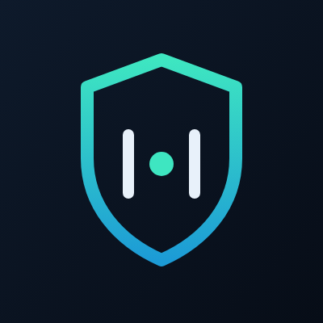

# Agent Guard Check

Agent Guard Check shows what each AI agent configured in a repository can do, and flags authority
it does not need. It reads Claude Code settings and subagents, `.mcp.json`, Codex and Gemini
settings, Copilot custom agents, plugin marketplaces and GitHub workflows that run agents. For
every agent you see which of these it can do, and whether a person is asked first: read private
data, take in untrusted input, write, run code, send data out, spend money, change its own
instructions.

The plugin adds a skill that tells your coding agent to check before and after it changes agent
configuration, how to read the result and how to fix a finding without silencing it.

## Install

Install **Agent Guard Check** from your agent's plugin directory. It needs Node.js 22 or newer
with npm on your computer, and an agent that can run commands there: Claude Code, Cowork, Codex,
or the ChatGPT desktop app in a thread that works on your local files. In a chat with no access to
your files there is nothing for it to read.

## What it runs, reads and sends

- **Runs:** the skill has the agent run
  `npx --yes @shieldaai/agent-guard-check@1.7.0 <repository>` from a temporary folder outside the
  repository, so the repository's own `.npmrc` or `node_modules` cannot change which scanner
  runs. The version is pinned and changes only with a new plugin version, and the package pins
  its two dependencies exactly (neither has its own), so it always runs the same code. If a sandbox blocks
  network access, the agent asks you before the first run.
- **Downloads:** npm fetches the package from the registry in your own npm settings
  (`registry.npmjs.org` unless you changed it) the first time, then uses its cache. The package
  is open source: [packages/check](https://github.com/ShieldaAI/agent-guard/tree/main/packages/check).
- **Reads:** agent configuration files in the repository, and git objects when it compares with
  a commit. Nothing outside the repository.
- **Sends:** nothing to Shielda or anyone else: no telemetry, nothing stored. Results go only to
  your agent session. See [PRIVACY.md](PRIVACY.md).
- **Never:** runs repository code. The scanner only reads; when you ask the agent to fix a
  finding, it edits files with its own tools, under the permissions you already set.

## Limits

The scanner judges configuration, not what a server or tool does at run time: a clean scan is not
proof that an agent is safe. Agents and settings it cannot read are reported as `unknown`, which
counts as a risk. The full rule list is in
[docs/rules.md](https://github.com/ShieldaAI/agent-guard/blob/main/packages/check/docs/rules.md).

## Also available

- In CI: the [Agent Guard Check GitHub Action](https://github.com/ShieldaAI/agent-guard/tree/main/packages/check#github-action)
  fails a pull request that widens an agent's authority.
- On every Claude Code session: the `--hook` mode checks your local and personal settings at
  session start. See [the hook docs](https://github.com/ShieldaAI/agent-guard/tree/main/packages/check#on-every-claude-code-session---hook).

## Support and license

Questions and bugs: [GitHub issues](https://github.com/ShieldaAI/agent-guard/issues). Security
reports: [private vulnerability reporting](https://github.com/ShieldaAI/agent-guard/security/advisories/new).
Licensed under Apache-2.0 (see [LICENSE](LICENSE)). Made by [Shielda](https://shielda.ai).
