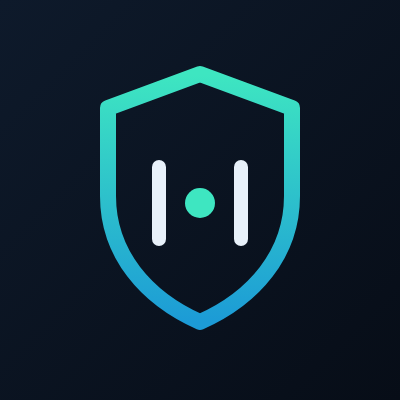

# Agent Guard Check



Agent Guard Check shows what each AI agent configured in a repository can do, and flags authority
it does not need. It reads Claude Code settings and subagents, `.mcp.json`, Codex and Gemini
settings, Copilot custom agents, plugin marketplaces and GitHub workflows that run agents. For
every agent you see which of these it can do, and whether a person is asked first: read private
data, take in untrusted input, write, run code, send data out, spend money, change its own
instructions.

<!-- mcp:start -->
The plugin gives your coding agent two things:

- **A skill** that tells the agent to check before and after it changes agent configuration, how
  to read the result and how to fix a finding without silencing it.
- **A read-only MCP server** with three tools:
  - `scan_agent_config`: every agent's authority and all findings, each with a file, a line and a fix.
  - `check_agent_config_change`: compares the working tree with a git commit (such as `HEAD` or
    `origin/main`) and reports only what the change made worse.
  - `explain_agent_rule`: what a rule such as `AGC-TRI-001` flags and why.

## Example

A project whose `.claude/settings.json` allows `Read`, `WebFetch` and `Bash(curl:*)`. Asked
"What can the AI agents in this repository do without asking first?", the agent calls
`scan_agent_config` and gets:

```text
Claude Code (project) (.claude/settings.json): reads untrusted input: yes, no approval; writes: yes, no approval; runs code: yes, no approval; sends data out: yes, no approval; changes itself: yes, no approval

Findings (3):
- [high] AGC-COV-001 at .claude/settings.json:3: Claude Code (project) can send data out and run code without approval (WebFetch, Bash(curl:*)), and nothing checks those calls at runtime. Fix: Add a runtime check that sees these calls: a PreToolUse hook whose matcher names these tools, or route them through Agent Guard or an MCP gateway.
- [high] AGC-PERM-003 at .claude/settings.json:3: "Bash(curl:*)" runs without asking and can reach the network or run arbitrary code. Fix: Keep this command behind approval, or narrow it to a fixed script that cannot take arbitrary arguments.
- [low] AGC-GOV-001 at .claude/settings.json:1: No CODEOWNERS file covers agent configuration. Fix: Add CODEOWNERS entries for .claude/, .mcp.json, CLAUDE.md and .github/workflows/.
```

## Install

Claude Code:

```text
/plugin marketplace add ShieldaAI/agent-guard
/plugin install agent-guard-check@shielda
```

Codex: `codex plugin marketplace add ShieldaAI/agent-guard`, then install **Agent Guard Check**
from the plugin directory in the app.

Antigravity CLI: `agy plugin install` with the path to this folder in a clone of the repository.

It needs Node.js 22 or newer with npm, and a host that runs local programs: Claude Code, Codex,
the ChatGPT and Claude desktop apps, Antigravity. In a chat with no access to your files there is
nothing for it to read.

## What it runs, reads and sends

- **Runs:** when a session starts, `scripts/start-mcp-server.mjs` runs
  `npx --yes --package=@shieldaai/agent-guard-check@1.6.2 -- agent-guard-check-mcp <project>`
  with npm from the same Node.js installation. The version is pinned and changes only with a new
  plugin version. npx starts in the plugin's data folder (or a private temporary folder), not in
  the project, so the project's `.npmrc` and `node_modules` cannot change which scanner runs; npm
  settings passed in environment variables (`npm_config_*`) are dropped too, and npm reads only
  your own `~/.npmrc`.
  If the host does not say which project is open and its working folder is `/` or your home
  folder, the server does not start, rather than scan the wrong place.
- **Downloads:** npm fetches the package from the registry in your own npm settings
  (`registry.npmjs.org` unless you changed it) the first time, then uses its cache. The package
  is open source: [packages/check](https://github.com/ShieldaAI/agent-guard/tree/main/packages/check).
- **Reads:** agent configuration files under the open project, and git objects when
  `check_agent_config_change` compares with a commit. Nothing outside the project.
- **Sends:** nothing to Shielda or anyone else: no telemetry, nothing stored. Results go only to
  your agent session. The one network request besides the npm download: in a partial (blobless)
  clone, comparing with a commit can make git fetch a missing object from the repository's own
  remote. Versions after 1.6.2 turn that off. See [PRIVACY.md](PRIVACY.md).
- **Never:** runs repository code, writes files or changes settings. The MCP tools only read.
  When you ask the agent to fix a finding, it edits files with its own tools, under the
  permissions you already set.
<!-- mcp:end -->
<!-- skills-only:
The plugin adds a skill that tells your coding agent to check before and after it changes agent
configuration, how to read the result and how to fix a finding without silencing it.

## Install

Install **Agent Guard Check** from the plugin directory in the ChatGPT desktop app or Codex. It
needs Node.js 22 or newer with npm on your computer, and runs only in threads that work on your
local files.

## What it runs, reads and sends

- **Runs:** the skill has the agent run
  `npx --yes @shieldaai/agent-guard-check@1.6.2 <repository>` from a temporary folder outside the
  repository, so the repository's own `.npmrc` or `node_modules` cannot change which scanner
  runs. The version is pinned and changes only with a new plugin version. If a sandbox blocks
  network access, the agent asks you before the first run.
- **Downloads:** npm fetches the package from the registry in your own npm settings
  (`registry.npmjs.org` unless you changed it) the first time, then uses its cache. The package
  is open source: [packages/check](https://github.com/ShieldaAI/agent-guard/tree/main/packages/check).
- **Reads:** agent configuration files in the repository, and git objects when it compares with
  a commit. Nothing outside the repository.
- **Sends:** nothing to Shielda or anyone else: no telemetry, nothing stored. Results go only to
  your agent session. See [PRIVACY.md](PRIVACY.md).
- **Never:** runs repository code. The scanner only reads; when you ask the agent to fix a
  finding, it edits files with its own tools, under the permissions you already set.
-->

## Limits

The scanner judges configuration, not what a server or tool does at run time: a clean scan is not
proof that an agent is safe. Agents and settings it cannot read are reported as `unknown`, which
counts as a risk. The full rule list is in
[docs/rules.md](https://github.com/ShieldaAI/agent-guard/blob/main/packages/check/docs/rules.md).

## Also available

- In CI: the [Agent Guard Check GitHub Action](https://github.com/ShieldaAI/agent-guard/tree/main/packages/check#github-action)
  fails a pull request that widens an agent's authority.
- On every Claude Code session: the `--hook` mode checks your local and personal settings at
  session start. See [the hook docs](https://github.com/ShieldaAI/agent-guard/tree/main/packages/check#on-every-claude-code-session---hook).

## Support and license

Questions and bugs: [GitHub issues](https://github.com/ShieldaAI/agent-guard/issues). Security
reports: [private vulnerability reporting](https://github.com/ShieldaAI/agent-guard/security/advisories/new).
Licensed under Apache-2.0 (see [LICENSE](LICENSE)). Made by [Shielda](https://shielda.ai).
